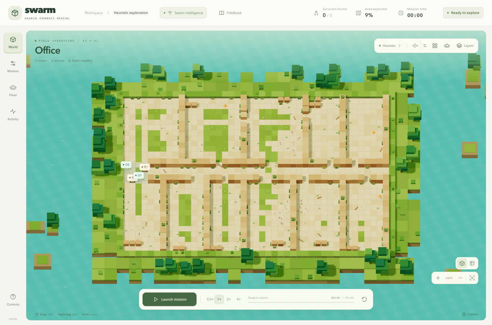
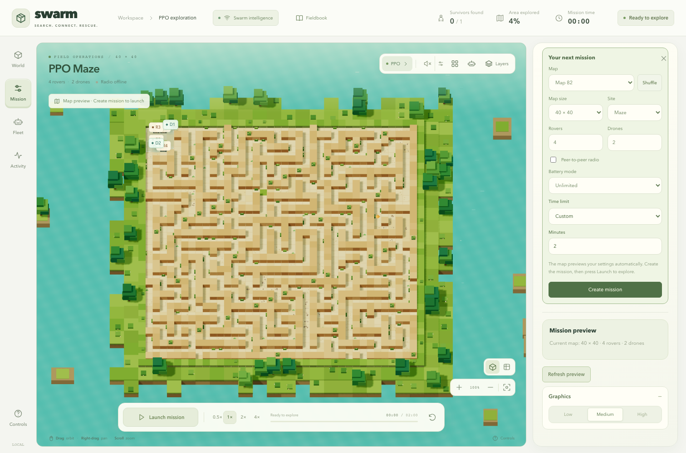
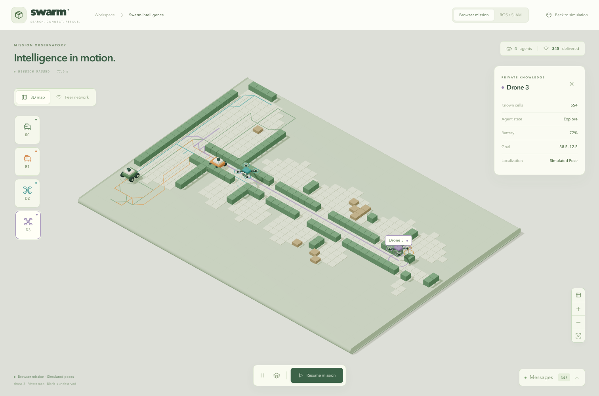
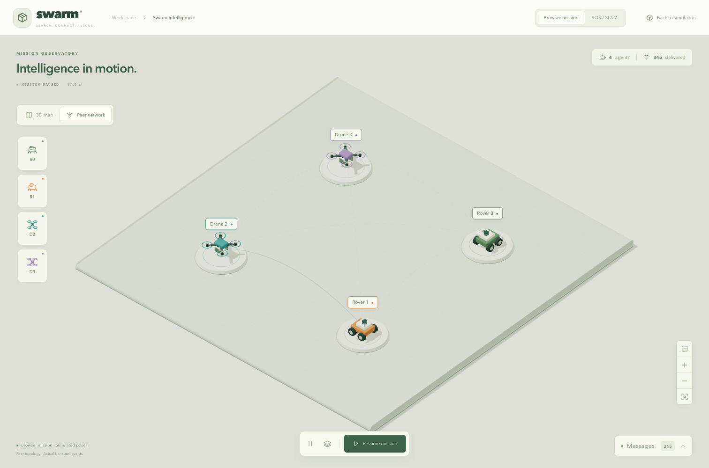
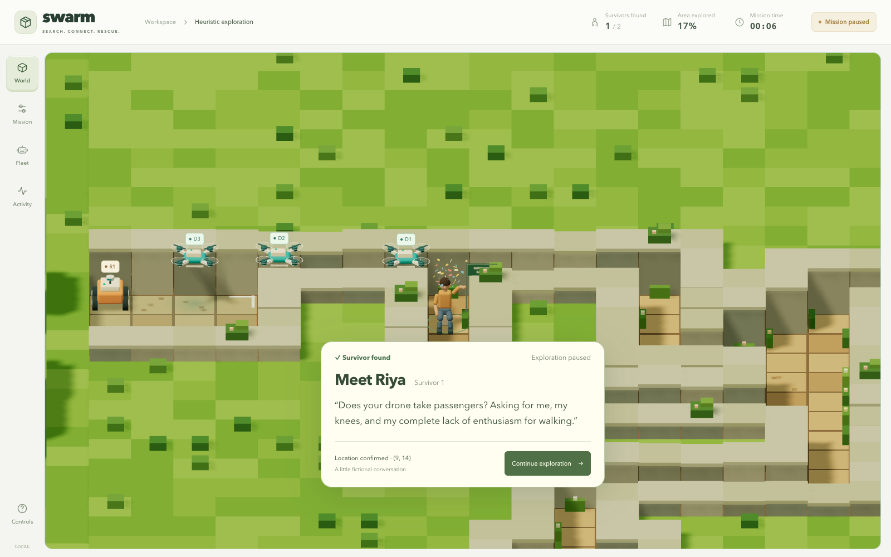
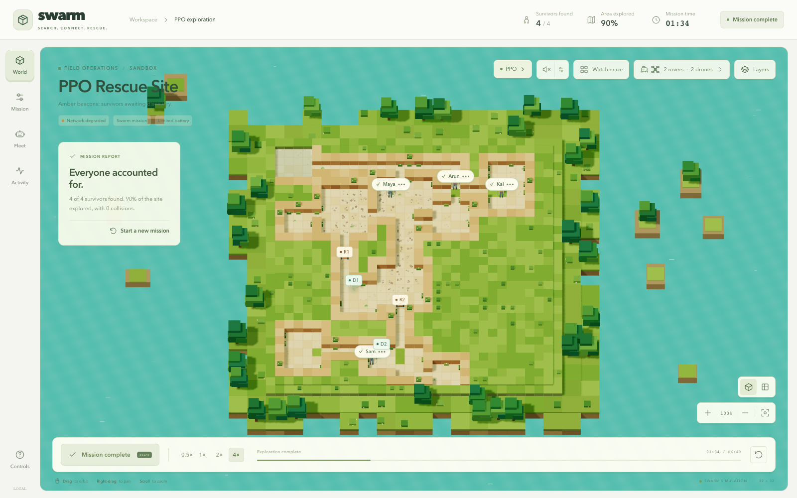
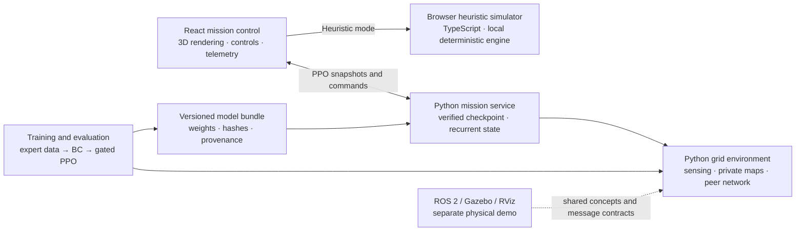

<div align="center">

# SWARM SAR

### Search together. Share discoveries. Find survivors.

A heterogeneous search-and-rescue research prototype with a 3D mission-control workspace, a deterministic Python simulator, learned rover/drone policies, and ROS 2 / Gazebo experiments.

[](pyproject.toml)
[](frontend/package.json)
[](frontend/package.json)
[](simulation/ros2_ws)
[](https://swarmsar.vercel.app)

[English audiobook](https://swarmsar.vercel.app) · [Watch the demos](#see-it-run) · [Run locally](#run-locally) · [Explore the architecture](#how-the-parts-connect) · [Read the evidence](#results-with-context) · [Choose a branch](#choose-a-branch)

</div>

[](docs/gallery.md)

<p align="center"><em>Recorded browser simulation: office map, two rovers and two drones, heuristic controller at 4× playback. Open the gallery for stills, run metadata, and other execution paths.</em></p>

## What you can explore

| Mission control | Swarm intelligence | Simulation and evaluation |
| :--- | :--- | :--- |
| Orbit, zoom, focus and follow individual robots | Local maps and noisy thermal/acoustic evidence | Deterministic rooms, caves, mazes and irregular worlds |
| Edit custom maze geometry and place survivors | Delayed, lossy peer-to-peer communication | Python environment with fixed observation/action contracts |
| Inspect fleet telemetry, radio links and discoveries | Frontier baseline and two shared recurrent PPO policies | Behavior cloning, PPO quality gates and development cohorts |
| Switch between heuristic and Python-backed PPO missions | Rover/drone terrain, sensing and battery differences | ROS 2 interfaces, physical robot models, Gazebo and RViz |

## Latest integration · 31 October 2026

- **Rover SLAM source integration:** separate `slam_toolbox` instances, estimated rover feedback, private occupancy maps, known-start alignment and radio-delivered map snapshots/frontier intent. Local source/protocol checks pass; live Linux SLAM, demonstrated loop closure and the missing host PPO controller remain explicit validation work. [Integration guide](docs/guides/slam_integration.md) · [Linux validation prompt](docs/guides/LINUX_SLAM_VALIDATION_PROMPT.md).
- **3D swarm observatory:** measured occupancy, rover/drone models, trajectories, actual message arcs, selected-agent knowledge, packet filters/export, top-down camera and graphics recovery. Browser and ROS sources are labelled separately. [Open locally](http://127.0.0.1:5173/?mode=observatory) · [Guide](docs/guides/swarm_observatory.md).
- **Automatic PPO setup preview:** seed, size, layout, fleet, radio, battery and duration update the Python-generated preview before **Create mission**. Creation matches that preview; **Launch** starts saved-policy inference. [Implementation and checks](docs/guides/ppo_frontend_integration.md).
- **Large-map investigation:** frozen-checkpoint diagnostics, persistence/loop experiments, information-gain and frontier-diversity ablations, and a locked 32/56/64-cell development benchmark. These experiments are retained as evidence, not promoted as a proven large-map upgrade. [Baseline results](docs/audits/frozen_discovery_baselines.md) · [Protocol](docs/benchmarks/README.md).
- **One command and a narrated guide:** `npm run swarm` starts the frontend, PPO service and local audiobook. [Read/listen online](https://swarmsar.vercel.app), including the new integration chapters and source atlas.

| Current mission-control workspace | Actual Python-generated PPO preview |
| :---: | :---: |
|  |  |

| Private-map observatory | Peer transport topology |
| :---: | :---: |
|  |  |

These are captures of the running browser application. The observatory examples use **browser simulator telemetry**, not a live SLAM session or GNN activations. The original physical Gazebo/RViz host captures appear below with their provenance. [New capture manifest](docs/media/updates/capture-manifest.json).

## See it run

Every image below is a real application capture or a recording of an executed simulation. The Gazebo views show different camera angles of **one supplied world and one team**, not multiple validated maps.

### 3D mission control

| Office · 2 rovers + 2 drones | Mine · 1 rover + 3 drones |
| :---: | :---: |
| [](docs/media/frontend/office-overview.png) | [](docs/media/frontend/mine-team.png) |

<details>
<summary><strong>Explore fleet telemetry, another map, and a trained-policy mission</strong></summary>

| Fleet inspection | Apartment · 3 rovers + 1 drone |
| :---: | :---: |
|  |  |



The PPO image shows development seed **10000**, using the shipped **753664-step** checkpoint: **4/4 survivors in 94 steps**. It demonstrates that the browser renders the Python policy's mission. [Capture metadata](docs/media/frontend/capture-manifest.json) records state and source hashes.

</details>

### 2D learned-policy mission

[](docs/guides/ppo_demo.md)

The Python renderer records the same development example: two rovers, two drones, private-map exploration, **4/4 survivors**, and **90.48% coverage**. [Inference record](docs/validation/ppo_demo_validation.json) · [Reproduce this demo](docs/guides/ppo_demo.md)

### Gazebo physics and RViz mapping

| Gazebo · original host capture | RViz · original host capture |
| :---: | :---: |
| [](docs/media/simulation-screenshots/03-gazebo-overview.png) | [](docs/media/simulation-screenshots/10-rviz-progress.png) |

<details>
<summary><strong>Watch the recorded RViz map sequence and inspect the source captures</strong></summary>


This animation cycles through original screenshots from the same host session. It is a sequence of recorded states rather than a continuous video. The supplied run used **one rover and two drones**. [All ten captures](docs/media/simulation-screenshots/) · [Capture manifest](docs/media/simulation-screenshots/capture-manifest.json) · [Original ROS launch log](docs/media/simulation-screenshots/run.log)

The supplied log reports loaded PPO actors. Its actor hashes differ from the selected grid-policy handoff, and the corresponding host implementation is not in this checkout. The checked-in default physics launch uses waypoint controllers. These captures establish the supplied Gazebo/RViz session; they do not establish reproduction of that host's learned-policy integration from this repository. [Execution-path details](docs/gallery.md#gazebo-and-rviz)

</details>

## Run locally

### Start the complete local workspace

After the one-time dependency setup:

```bash
npm run swarm
```

| Service | Address |
| :--- | :--- |
| 3D mission control | http://127.0.0.1:5173/ |
| Swarm observatory | http://127.0.0.1:5173/?mode=observatory |
| ROS telemetry view | http://127.0.0.1:5173/?mode=ros |
| Local English audiobook | http://127.0.0.1:8088/ |
| PPO health | http://127.0.0.1:8765/api/ppo/health |

The launcher checks dependencies, reuses healthy servers, waits for the verified
checkpoint and reports startup failures. Ctrl+C stops the processes it started.
It does not replace unrelated processes on occupied ports. Use
`npm run swarm -- --check` for a read-only readiness check.

<details>
<summary><strong>First-time setup</strong></summary>

Install Node.js 18+ and Python 3.12+, then:

```bash
git clone https://github.com/rashiyaom/swarm-sar.git
cd swarm-sar
npm --prefix frontend ci
python3 -m venv .venv
.venv/bin/python -m pip install -e .
npm run swarm
```

On Windows use `.venv\Scripts\python.exe` for the install command. Generating
new narration requires macOS TTS/FFmpeg; playing the included narration does not.

</details>

The ROS page opens locally, but ROS/Gazebo, `slam_toolbox` and rosbridge must run
on the sourced Linux ROS host. `npm run swarm` does not emulate those services.
See [SLAM launch and validation](docs/guides/slam_integration.md). To run only
the browser heuristic sandbox, use `npm --prefix frontend run dev`.

| Control | Action |
| :--- | :--- |
| `Space` | Launch, pause or resume |
| Mouse drag / right-drag | Orbit / pan |
| Scroll / `+` / `−` | Zoom toward the cursor |
| `R` / `F` | Fit the world / focus the selected robot |
| `H` / `M` | Hide or restore the interface / toggle sound |
| Mission / Fleet / Activity | Configure the scenario / inspect agents / review events |

<details>
<summary><strong>Enable the saved PPO policy in the browser</strong></summary>

Use Python **3.12+** for the supplied checkpoint/service workflow. The simulator package declares Python 3.10+; checkpoint extraction uses the newer tar-file API. Local checks used Python 3.13.

```bash
python3 -m venv .venv
source .venv/bin/activate
python -m pip install -e .
python -m backend.ppo_service
```

Keep that terminal open, start Vite in a second terminal, and choose **Mission → PPO → Create mission**. The service verifies and extracts the bundled checkpoint into `training/runs/`, then performs CPU inference. It does not start training. [Full setup and behavior](docs/guides/ppo_frontend_integration.md)

</details>

<details>
<summary><strong>Run the Python simulator or inspect the training pipeline</strong></summary>

After installing the Python package from the repository root:

```bash
python simulation/scripts/view_world.py
python simulation/scripts/play_manual.py
python simulation/scripts/run_frontier_baseline.py
python training/scripts/run_gpu_pipeline.py --plan
```

For the audited Linux/NVIDIA experiment, use the dedicated [gpu-training branch](https://github.com/rashiyaom/swarm-sar/tree/gpu-training). Its original source layout, training contract, and immutable release tag are preserved. [Training overview](training/README.md) · [Validation commands](docs/guides/validation_commands.md)

</details>

<details>
<summary><strong>Launch the checked-in ROS 2 / Gazebo physics demo</strong></summary>

Use a compatible ROS 2 / Gazebo installation. The recorded physics validation used ROS 2 Lyrical and Gazebo Sim 10; older Jazzy/Harmonic setup notes are also retained.

```bash
cd simulation/ros2_ws
source /opt/ros/lyrical/setup.bash
colcon build --symlink-install
source install/setup.bash
ros2 launch swarm_sar_gazebo swarm_sar_sim.launch.py
```

The default demo spawns **one rover and two drones** with waypoint control. It opens RViz after simulation readiness checks. [Physics demo guide](docs/guides/physics_demo.md) · [ROS package layout](docs/guides/ros2_gazebo.md)

</details>

## How the parts connect



Policy decisions use local observations and received peer information. The simulation layer also applies collision shielding, so recorded zero-collision outcomes do not establish learned collision avoidance. ROS physics, browser heuristics, and learned grid-policy execution have different validation scopes.

<details>
<summary><strong>Browse the repository by responsibility</strong></summary>

```text
frontend/                 React UI, browser engine, audio and browser tests
backend/                  Python HTTP mission service
simulation/
  src/swarm_sar/           Python simulator and shared learning modules
  scripts/                 Viewers, baselines, audits and ROS probes
  ros2_ws/                 Robot models, worlds, messages and launch files
training/
  configs/                 Learning settings, cohorts, gates and seed splits
  scripts/                 Expert export, BC/PPO, evaluation and GPU pipeline
  datasets/                Shipped expert demonstrations
  artifacts/               Contracts, summaries and integrity manifests
  runs/                    Ignored generated output and extracted handoffs
models/                    Selected PPO handoff and original Step 3 checkpoint
configs/                   Shared world, robot and network parameters
docs/                      Guides, reports, audits, media and original evidence
tests/                     Backend, simulator, training and ROS checks
```

[Repository guide](docs/README.md) · [Architecture](docs/architecture/architecture.md) · [Relocation map](docs/reference/structure-moves.json)

</details>

## Results with context

| Recorded result | What it measures | Source |
| :--- | :--- | :--- |
| **563/564** survivors; **199/200** complete missions | Historical browser heuristic audit across 50 layouts × 4 network conditions | [Browser audit](docs/validation/browser_swarm_audit.json) |
| **40/42** survivors over 12 networked missions | Historical Python decentralized-controller audit | [Step 4 report](docs/audits/step4_validation.md) |
| **88.80%** combined development mean cohort recall | Selected 753664-step GPU PPO candidate; paired expert: 87.13% | [Checkpoint review](models/ppo_754k/ppo_754k_review.json) |
| **4/4** survivors in **94** steps | One reproducible development PPO mission, seed 10000 | [2D inference record](docs/validation/ppo_demo_validation.json) |
| **160** Python tests passed; **2** ROS-dependent skips; **140** frontend tests passed | Local repository checks after reorganization | [Check record](docs/validation/repository_checks.md) |

These are bounded synthetic experiments. The selected checkpoint is weakest on large mazes; model selection used development data, and final-test seeds remain sealed. Custom battery/time options, camera changes, or a different fleet do not inherit the benchmark results above. [Project report](docs/project_report.md) · [Readiness audit](docs/audits/hackathon_readiness_audit.md)

## Choose a branch

| Branch | Purpose | Contents |
| :--- | :--- | :--- |
| [`main`](https://github.com/rashiyaom/swarm-sar/tree/main) | Full project | Integrated frontend, backend, simulator, training, models and documentation |
| [`rashiyaom`](https://github.com/rashiyaom/swarm-sar/tree/rashiyaom) | Full project mirror | Same reviewed project snapshot as `main` |
| [`frontend`](https://github.com/rashiyaom/swarm-sar/tree/frontend) | Frontend workspace | Current React application, browser engine, UI tests and frontend media |
| [`simulator_web`](https://github.com/rashiyaom/swarm-sar/tree/simulator_web) | Browser simulator workspace | Browser simulation, runnable visual shell, deterministic tests and controller notes |
| [`gpu-training`](https://github.com/rashiyaom/swarm-sar/tree/gpu-training) | Audited GPU experiment | Original Python training runtime, expert dataset, gates and operator instructions |
| [`gpu-754k-handoff`](https://github.com/rashiyaom/swarm-sar/tree/gpu-754k-handoff) | Model handoff | Selected checkpoint archive, checksums, development review and recorded 2D demonstration |

[Branch scope and maintenance](docs/branches.md). Focused branches retain the dependencies they need; branch cleanup does not rewrite old commits or release tags.

## Verify and contribute

```bash
python -m pytest -q
npm --prefix frontend test
npm --prefix frontend run build
python training/scripts/freeze_training_baseline.py --verify
python training/scripts/verify_policy_contract.py
python training/scripts/freeze_gpu_release.py --verify
```

Keep model weights, dataset chunks, sealed evaluation definitions, and original evidence traceable. Include the affected execution path and its validation when proposing a change. For a starting point, open the [documentation index](docs/README.md), [project report](docs/project_report.md), or [real-capture gallery](docs/gallery.md).
