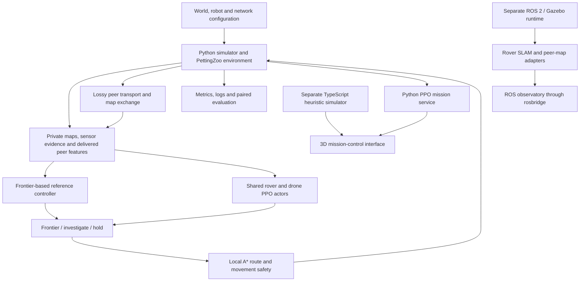

# SWARM SAR — Detailed Project Approach

### Decentralized exploration, shared discoveries and learned goal selection for simulated search and rescue

SWARM SAR explores how a heterogeneous team of rovers and drone agents can search an unknown disaster site, exchange partial knowledge over unreliable communication links, and locate simulated survivors. Our approach combines a deterministic simulation environment, private robot maps, synthetic thermal/acoustic sensing, a working frontier-based controller, and cooperative reinforcement learning. A 3D mission-control interface makes the agents' behavior and information exchange observable.

We developed the system incrementally: establish a repeatable task, solve it with a measurable baseline, introduce learning through a stable interface, model communication failures, and then connect the results to browser and robotics demonstrations. This gave us a working reference at each stage and a way to assess whether additional complexity improved search behavior.

> **Project scope:** This is a research simulation prototype. The Python learned-policy mission, browser heuristic simulation and ROS/Gazebo experiments have distinct execution and validation scopes. Synthetic survivor confirmation establishes location in simulation; it does not represent physical evacuation or field-tested detection accuracy.

## Contents

- [1. Problem and design goals](#1-problem-and-design-goals)
- [2. Overall architecture](#2-overall-architecture)
- [3. Building a reproducible environment](#3-building-a-reproducible-environment)
- [4. Local perception and private maps](#4-local-perception-and-private-maps)
- [5. Establishing the exploration baseline](#5-establishing-the-exploration-baseline)
- [6. Decentralized peer cooperation](#6-decentralized-peer-cooperation)
- [7. Cooperative reinforcement learning](#7-cooperative-reinforcement-learning)
- [8. Training and checkpoint selection](#8-training-and-checkpoint-selection)
- [9. Connecting learned missions to the browser](#9-connecting-learned-missions-to-the-browser)
- [10. ROS, Gazebo and rover SLAM](#10-ros-gazebo-and-rover-slam)
- [11. Validation and measured results](#11-validation-and-measured-results)
- [12. Running and navigating the project](#12-running-and-navigating-the-project)
- [13. Limitations and next steps](#13-limitations-and-next-steps)

## 1. Problem and design goals

The [problem statement](docs/problem_statement.md) asks for a decentralized multi-agent reinforcement learning framework coordinating autonomous drones and ground rovers in dangerous, GPS-denied environments. The robots need to explore unknown spaces, detect survivors from thermal/acoustic evidence, and share mapping information peer to peer.

We translated that challenge into six engineering goals:

| Goal | Our implementation approach |
|---|---|
| Search an unknown environment | Generate seeded disaster maps and give each robot a private, initially unknown occupancy belief |
| Represent a heterogeneous team | Use different rover/drone sensing, communication, energy and traversal parameters |
| Locate survivors from local evidence | Generate noisy thermal/acoustic cues and require an investigation/confirmation process |
| Coordinate without a goal-allocation server | Exchange observations, frontier intent and evidence through recipient-specific peer messages |
| Learn useful cooperative behavior | Train two type-shared recurrent PPO policies using local observations and a team reward |
| Make results inspectable | Preserve deterministic runs, compare controllers on matched cases, and display real runtime telemetry |

The exact challenge makes MARL a core requirement. The heuristic controller provides a reference and a usable fallback, while the trained-policy path supplies the learning component. We assess them separately.

## 2. Overall architecture

We separated environment dynamics, decisions, communication, training and presentation. A viewer can inspect global simulation state, while an agent's decision interface exposes only its permitted local information.



The repository supports three visible runtime paths:

| Path | Where decisions and simulation run | Purpose |
|---|---|---|
| **Browser heuristic** | TypeScript engine and decentralized frontier controller in the browser | Interactive exploration, scenario authoring and communication demonstrations |
| **Python PPO** | Saved actors and the authoritative Python environment; browser renders snapshots | Demonstrate actual learned-policy execution through the 3D interface |
| **ROS/Gazebo** | Linux ROS nodes, physical simulator, configured motion controllers and mapping processes | Investigate physical models, simulated sensors, estimated mapping and robotics integration |

The browser heuristic implementation follows the Python controller's principles, but uses a different random-number generator and scenario generator. An identical seed does not guarantee the same world across these two implementations. The PPO browser path avoids this ambiguity by using Python's actual world and state.

Implementation references: [architecture](docs/architecture/architecture.md), [controller compatibility](frontend/CONTROLLER_COMPATIBILITY.md), [PPO integration](docs/guides/ppo_frontend_integration.md).

## 3. Building a reproducible environment

### 3.1 Seeded disaster worlds

We first built the environment independently of learning. It generates rooms, corridors, caves, mazes, rubble and irregular site footprints. Reachability checks remove disconnected traversable areas, and survivor placement enforces reachable locations with configurable distance and separation constraints.

The world owns a seeded random-number generator used by generation, placement, sensor noise, odometry drift and movement-conflict resolution. Within a given implementation and configuration, the same seed and action sequence reproduce the same episode. This makes a failed mission something we can inspect and replay.

The occupancy representation is deliberately small:

| Value | Meaning |
|---:|---|
| `-1` | Unknown in a robot's belief |
| `0` | Free space |
| `1` | Blocking wall |
| `2` | Traversable rubble |

The true world grid supports physics, sensor emulation, evaluation and debugging. Each robot maintains a separate belief array; finding a cell does not automatically reveal it to teammates.

Sources: [world generation](simulation/src/swarm_sar/world/generator.py), [reachability](simulation/src/swarm_sar/world/reachability.py), [survivor placement](simulation/src/swarm_sar/world/victims.py).

### 3.2 Heterogeneous agents

The default grid team contains two rovers and two drone proxies. We use different capabilities so robot type affects the search task rather than only its appearance.

| Base configuration | Rover | Drone |
|---|---:|---:|
| Occupancy vision radius | 4 cells | 7 cells |
| Thermal radius | 6 cells | 8 cells |
| Acoustic radius | 10 cells | 12 cells |
| Communication radius | 8 cells | 10 cells |
| Initial battery | 300 units | 240 units |
| Ordinary movement cost | 1 unit | 1 unit |
| Rubble movement cost | 2 units | 1 unit |
| Confirmation radius | 2 cells | 2 cells |

These are [base simulation parameters](configs/robots.yaml); domain randomization and mission options can override them. Both grid types move on a 2D lattice and cannot cross walls. Browser altitude, rotor animation and hovering are presentation features; physical drone dynamics belong to the separate Gazebo path.

### 3.3 Environment interface and movement

The [core engine](simulation/src/swarm_sar/sim/engine.py) handles simultaneous movement, energy, sensing and metrics. The [PettingZoo environment](simulation/src/swarm_sar/sim/env.py) exposes parallel multi-agent observations and high-level actions.

We separated selecting a search target from executing movement. A controller chooses a frontier or investigation action; A* supplies a local route, and the environment executes a movement step. This reduces the policy's action space and retains an interpretable planner.

Movement resolution blocks duplicate destinations and head-on swaps while allowing valid follow-the-leader chains. A safety layer also resolves some corridor conflicts. These mechanisms are part of the simulated system: collision-free results after shielding cannot be attributed entirely to learned coordination.

## 4. Local perception and private maps

### 4.1 Occupancy sensing

We use line-of-sight ray casting to update each robot's private map. Walls occlude cells behind them, while the visible wall itself can become known. The agent plans through its own explored traversable cells rather than receiving the entire disaster map.

### 4.2 Thermal and acoustic evidence

The [sensor model](simulation/src/swarm_sar/sensing/victim_sensor.py) generates evidence from hidden simulated survivor state:

- **Thermal sensing** returns four directional sectors, with range decay, line-of-sight restrictions, noise, misses and false positives.
- **Acoustic sensing** returns an omnidirectional cue. Intervening walls attenuate its strength rather than simply blocking it.
- **Investigation** can move toward locally supported evidence and fuse an additional sensor sample.
- **Confirmation** checks configured physical range and visibility within the simulator and records the discovery.

We use strong thermal evidence, or weaker thermal evidence corroborated by acoustic information, to trigger investigation in the decentralized baseline. This gives uncertain cues a role in behavior without exposing hidden survivor coordinates to the controller.

The sensor outputs are numerical proxies. We do not process real thermal images, estimate microphone bearings from recordings, or claim measured real-world sensor precision.

### 4.3 Localization assumptions

The grid environment includes drifting odometry and uncertainty features, and rejects some uncertain map exchanges. However, common-grid registration and exact own-cell information still assist grid sensing/planning. We treat this as an abstraction for testing search behavior. The separate rover SLAM integration addresses estimated localization in ROS; it does not retroactively make the grid experiments SLAM experiments.

## 5. Establishing the exploration baseline

We built a non-learning solution before training so that we could verify the task and compare learned behavior against a useful reference.

The baseline follows this sequence:

1. Detect **frontiers**: known-free cells adjacent to unknown space.
2. Cluster frontier cells and select reachable representatives.
3. Plan routes using A* on the robot's private belief.
4. Prefer useful exploration targets while accounting for received claims and evidence.
5. Investigate promising survivor cues.
6. Continue until survivors are confirmed, the mission times out, or the fleet is depleted.

The repository retains two baseline designs. The [earlier coordinated baseline](simulation/src/swarm_sar/baselines/frontier.py) uses reservations and shared evidence bookkeeping as a benchmark. The [decentralized baseline](simulation/src/swarm_sar/baselines/decentralized.py) makes each agent's choices from private state and delivered peer messages, without a global reservation table.

For decentralized exploration, rendezvous hashing assigns coarse spatial branches among currently known participants. This produces stable preferences and allows reassignment as peers appear or disappear. Received goal claims help avoid duplicate targets, while deterministic tie-breaking resolves competing claims.

We also maintain a [private topological graph](simulation/src/swarm_sar/mapping/topology.py) for mapping artifacts and survivor/frontier structure. NetworkX represents these graphs. It is not a GNN, and the existence of a graph export does not mean a neural policy performs graph message passing.

## 6. Decentralized peer cooperation

### 6.1 Messages carry bounded knowledge

Each robot broadcasts an explicit [peer envelope](simulation/src/swarm_sar/network/messages.py) containing sender/sequence identity, timestamps, frame, uncertain pose and a bounded payload. Payloads can include frontier advertisements, current intent, sensor evidence and occupancy-map chunks.

The [transport](simulation/src/swarm_sar/network/peer.py) routes messages to individual recipients. It models radio range, wall attenuation, packet loss, delay, bandwidth limits, expiry and temporary partitions. Delivery is deterministic for the configured seed and action history.

An agent can act on a peer's information only after receiving it. A central simulation process emulates the world and radio channel, but the decentralized high-level controller does not receive a shared global goal allocator.

### 6.2 Merging and recovering information

Recipients deduplicate messages and check frame/uncertainty rules before accepting map cells. Delivered occupancy supplements a receiver's unknown cells; it does not directly replace its policy with the sender's decisions.

Periodic bounded snapshots provide another chance to receive cells missed during loss or isolation. Robots continue local exploration without communication. Reconnection restores opportunities to share knowledge; it does not imply instantaneous synchronization.

A useful cooperation trace is:

```text
Robot A observes a region or survivor cue
    → A sends a bounded message
    → the channel delivers, delays or drops it
    → Robot B accepts a valid delivery
    → B updates its private knowledge or responds to the advertised intent
```

The interface exposes these events so communication can be inspected causally. A line between robots indicates a link; it does not, by itself, establish delivery or improved search efficiency.

## 7. Cooperative reinforcement learning

### 7.1 Learning high-level decisions

We use PyTorch and RLlib PPO to learn goal selection above the existing perception, planner and safety mechanisms. The action contract is fixed:

| Action | Meaning |
|---|---|
| `0–4` | Select one of up to five locally generated frontier candidates |
| `5` | Investigate sensor evidence |
| `6` | Hold |

An action mask prevents selection of unavailable frontier slots and other masked choices. The candidate ordering used to construct observations must match the ordering used to execute actions; otherwise a valid-looking action could select the wrong destination.

### 7.2 Two shared policies with individual memory

All rover agents use `rover_policy`; all drone agents use `drone_policy`. Each type learns its own parameters, while each agent maintains independent recurrent state. Adding another rover therefore reuses the rover network rather than creating a new policy from scratch.

The recurrent GPU-v1 configuration uses a 256-cell LSTM to retain temporal context from partial observations and delayed communication. Actors receive local information and share a cooperative reward. This is type-shared cooperative PPO with decentralized actor inputs; we do not implement a centralized MAPPO critic or a learned graph-communication network.

Sources: [PPO construction](simulation/src/swarm_sar/learning/training.py), [action masking](simulation/src/swarm_sar/learning/rllib_module.py), [recurrent inference](simulation/src/swarm_sar/learning/inference.py).

### 7.3 Versioned observations

The current [GPU-v1 contract](simulation/src/swarm_sar/policy_contract.py) encodes **229 values**, plus a separate seven-action mask:

| Group | Encoded values |
|---|---:|
| Original local-map, battery, sensor/history, odometry, frontier and peer-summary fields | 129 |
| Previous high-level action | 7 |
| Active-goal features | 4 |
| Mission progress | 1 |
| Eight bounded peer slots, each with 11 features | 88 |
| **Total** | **229** |

We normalize and bound features in the [observation encoder](simulation/src/swarm_sar/learning/observation.py). Hidden survivor coordinates and the full truth map are excluded from actor input. Global simulation information is still available to physics, reward computation, evaluation and explicit viewer/debug layers.

The historical Step 3 model uses the older 129-value interface. Shared inference utilities support that historical prefix where appropriate, while the current browser PPO service requires the selected 229-value actors. Shape compatibility alone is insufficient: feature meaning, ordering, scaling and action-slot semantics must also agree.

### 7.4 Cooperative reward

The [learning wrapper](simulation/src/swarm_sar/learning/env.py) assigns a shared team reward:

```text
reward = survivor_weight × newly confirmed survivors
       + exploration_weight × newly discovered team cells
       + evidence_weight × investigation evidence
       − collision count
       − step penalty
```

The GPU training configuration uses survivor weight `50`, exploration weight `0.02`, evidence weight `0`, and a `0.01` step penalty. Newly discovered cells are counted through the union of team knowledge, preventing repeated reward for the same coordinate when another robot revisits it or receives it through a message. These weights belong to the learning configuration; they are distinct from the underlying PettingZoo environment's own rewards.

### 7.5 Experimental GNN extension

An optional [GNN-PPO experiment](experiments/gnn/README.md) now adds a learned receiver-local graph-attention branch before the recurrent PPO encoder. Graph nodes represent the receiving robot and its delivered peer advertisements; masked peer slots cannot contribute. Its residual starts at zero so the selected original actor can initialize a candidate without changing initial behavior. The observation/action contract, radio transport, planner and sensor models remain the same.

The implementation has CPU optimizer, distributed sampling, checkpoint/resume and paired-diagnostic validation. The tiny smoke-trained candidate regressed and was not promoted; CUDA training and full-budget evaluation are still required. The default browser policy remains the original PPO model, and ROS/Gazebo has no new GNN controller. This extension is distinct from the default architecture described above and does not establish improved cooperation merely by existing.

## 8. Training and checkpoint selection

### 8.1 Expert demonstrations and behavior cloning

We warm-start learning with demonstrations from a policy-compatible decentralized expert. The teacher emits actions through the learner's observation/action interface, preserving frontier-slot meaning and stable robot identity.

The corrected shipped dataset contains **868,887 decisions from 2,000 maps**, stored in 18 compressed chunks. Integrity manifests and validation tools check data shapes, hashes, masks, identities and seed metadata.

Behavior cloning uses class weighting to address uneven action frequencies, trajectory-aware splits to avoid mixing the same trajectory across partitions, and recurrent sequence windows with burn-in. Classification accuracy is a diagnostic; we also execute the cloned policies in complete missions to see whether they actually search and confirm survivors.

Sources: [demonstration collection](simulation/src/swarm_sar/learning/demonstrations.py), [behavior cloning](simulation/src/swarm_sar/learning/behavior_cloning.py), [dataset](training/datasets/README.md).

### 8.2 Bounded PPO and quality gates

We then run a PPO pilot and continue only when the evidence justifies more compute. Training varies supported map sizes, team compositions, sensors and communication conditions while preserving fixed policy interfaces. Worker seed schedules support distinct episodes and resumable progress.

The pipeline checks numerical health, legal actions, action collapse, recall/coverage floors and regression against reference performance. Checkpoints are numbered, hash-verified and accompanied by run metadata. A later checkpoint is not assumed to be better.

The selected checkpoint is **753,664 environment steps**. Its effective GPU definition uses **16 rollout runners**, overriding the incompatible 20-runner source configuration. A later checkpoint at 1,015,808 steps encountered quality-gate failures, so the earlier candidate was retained. This is why the effective run definition and evaluation report are part of the artifact.

Sources: [training pipeline](training/scripts/run_gpu_pipeline.py), [quality gates](simulation/src/swarm_sar/learning/training_gates.py), [selected checkpoint](models/ppo_754k/README.md).

### 8.3 Development and final evaluation boundaries

The [seed split](training/configs/seed_splits.yaml) separates training seeds `0–9999`, development seeds `10000–10099`, and final seeds `20000–20199`.

We use fixed development cases for comparisons and rotating shadow cases to inspect transfer beyond the fixed core. Evaluation includes different layouts, larger maps, team compositions and degraded communication/sensing. Paired references run on matching initial cases and budgets. Episode-level uncertainty estimates avoid treating individual victims as independent trials.

Final-test seeds remain sealed during development and checkpoint selection. Development scores used to choose a checkpoint are reported as development evidence. Later large-map experiments also use a [versioned benchmark](docs/benchmarks/README.md) with explicit discovery/confirmation allocations and rules rejecting incomplete or mismatched comparisons.

## 9. Connecting learned missions to the browser

### 9.1 Authoritative Python state

The [PPO mission service](backend/ppo_service.py) verifies the selected archive, checkpoint tree and restored policy parameters, then loads both actors on CPU. Each mission has its own environment and per-agent recurrent state. Serving inference does not start a training job.

The browser uses this lifecycle:

```text
Preview options → create mission → request one authoritative step
                → receive snapshot → update presentation → repeat
```

[PPOBridge](frontend/src/ppo/PPOBridge.tsx) manages requests and lifecycle behavior. [RemoteEngine](frontend/src/ppo/RemoteEngine.ts) adapts returned Python state to the rendering interface. Local browser heuristics and manual commands cannot advance a PPO mission.

We use an expected-step counter so a retried request cannot advance twice after a lost response. Late responses from replaced missions are ignored. Reset creates new state, discovery pauses retain the committed sequence, and connection loss pauses execution rather than silently substituting a heuristic controller.

### 9.2 Presentation that explains behavior

React, Three.js and React Three Fiber provide the 3D workspace; Zustand holds mission/UI state. The interface supports fleet inspection, private maps, evidence, network activity, playback and camera control. Heuristic mode also supports terrain and survivor authoring.

Rendering interpolates between committed simulation states. Optional Web Audio music, vehicle sounds and event cues remain outside the deterministic simulation. Discovery stories and celebrations respond to actual confirmation events, but their authored dialogue does not represent detected information about real people.

The observatory shows occupancy, trajectories, delivered-message information and selected-agent knowledge. Browser/PPO and ROS data are identified by source. Its spatial and network views are telemetry visualizations, not neural attention or GNN activations.

## 10. ROS, Gazebo and rover SLAM

We maintain a separate [ROS 2 workspace](simulation/ros2_ws) containing interfaces, robot descriptions, a disaster world, controllers, transport bridges and launch files. Gazebo provides physical vehicle/sensor simulation; RViz supports map and robot inspection. The default physics demonstration uses one rover and two drones with waypoint control, with other profiles available.

The newer [SLAM integration](docs/guides/slam_integration.md) adds independent rover `slam_toolbox` processes using simulated lidar and wheel odometry. An adapter projects local estimated maps and poses into the mission frame and exchanges bounded occupancy snapshots and leased exploration intent over the simulated radio.

We explicitly assign transform ownership: SLAM estimates map-to-odometry correction, wheel odometry supplies rover motion, and known starting positions align rover maps to the mission frame. Ground-truth rover odometry is separated onto diagnostic channels. Received peer knowledge supplements mapping belief without modifying the local pose graph.

This is local rover SLAM with peer-map/intent sharing. It is not unknown-start registration or joint distributed pose-graph optimization. Drone mapping still uses simulator-pose/raycast information.

Local geometry, protocol, launch structure and expanded robot-model checks exist. Live Linux validation of SLAM behavior, observed loop closure and the matching learned ROS controller remains a separate requirement. Supplied host logs refer to a PPO-capable implementation whose corresponding source is absent from this checkout; the selected grid actors cannot be assumed to reproduce that host run. The launch fails explicitly if a requested PPO executable is missing.

## 11. Validation and measured results

We validate components and full missions. Component tests cover generation, local sensing, movement, information boundaries, peer faults, observation/action compatibility, recurrent state, checkpoint integrity and browser state transitions. Mission evaluation reports survivor recall, completion, coverage, steps, invalid actions, collisions, energy and communication behavior.

| Recorded result | What it establishes | Evidence |
|---|---|---|
| **563/564 survivors; 199/200 complete missions** | Historical browser heuristic audit across 50 layouts under four network conditions | [Browser audit](docs/validation/browser_swarm_audit.json) |
| **88.80% combined mean cohort recall** | Selected 753,664-step policy's development performance; paired expert mean was 87.13% | [Checkpoint review](models/ppo_754k/ppo_754k_review.json) |
| **4/4 survivors in 94 steps; 90.48% coverage** | One reproducible saved-policy development mission, seed 10000 | [PPO mission record](docs/validation/ppo_demo_validation.json) |
| **160 Python tests passed; 2 skipped; 140 frontend tests passed; production build passed** | Historical repository verification recorded on 29 October 2026; these counts describe that check, not every later revision | [Verification record](docs/validation/repository_checks.md) |

These measurements have different controllers, conditions and denominators. Mean cohort recall is not interchangeable with pooled survivor recall. The selected model's development score does not establish statistical superiority, sealed-test performance or real-world reliability. Its large-maze cohort remained weak, including 5/18 survivors and 19.15% coverage.

We also retain unsuccessful experiments. Goal-persistence, frontier-utility and visibility/diversity investigations are recorded under [audits](docs/README.md) rather than promoted automatically as model improvements. Communication resilience is demonstrated as a mechanism; a general communication-driven speedup has not been established. Reported zero-collision outcomes include the simulator's safety layer.

## 12. Running and navigating the project

After installing Node.js 18+ and Python 3.12+ for the supplied checkpoint/service workflow, run from the project root:

```bash
npm --prefix frontend ci
python3 -m venv .venv
.venv/bin/python -m pip install -e .
npm run swarm
```

On Windows, use `.venv\Scripts\python.exe` for the Python install command. The simulator package itself declares Python 3.10+, while the supplied checkpoint extraction workflow needs the newer Python version.

The launcher starts or reuses healthy local frontend, PPO and fieldbook services:

| Service | Address |
|---|---|
| Mission control | `http://127.0.0.1:5173/` |
| Browser/PPO observatory | `http://127.0.0.1:5173/?mode=observatory` |
| ROS telemetry view | `http://127.0.0.1:5173/?mode=ros` |
| Local narrated fieldbook | `http://127.0.0.1:8088/` |
| PPO health endpoint | `http://127.0.0.1:8765/api/ppo/health` |

ROS/Gazebo, SLAM and rosbridge must run separately on the compatible sourced Linux host. Opening the ROS browser view does not start those services. See the [main README](README.md) for controls and the [SLAM guide](docs/guides/slam_integration.md) for host-specific launch and validation steps.

| Directory | Main responsibility |
|---|---|
| `configs/` | Shared world, robot and network settings |
| `simulation/src/swarm_sar/` | Python world, environment, sensing, planning, transport, learning and evaluation support |
| `simulation/ros2_ws/` | Physical simulation, ROS interfaces, controllers, SLAM and launch files |
| `training/` | Dataset export, BC/PPO scripts, gates, cohorts and integrity artifacts |
| `models/` | Selected model delivery and historical checkpoint |
| `backend/` | Local saved-policy mission service |
| `frontend/` | Browser simulator, mission control, learned-policy presentation and observatory |
| `tests/` | Python component and integration checks |
| `docs/` and `artifacts/` | Design explanations, bounded results, captures and experiment evidence |
| `guide-site/` | Narrated teaching material and generated source-linked fieldbook |

For a file-level reference, use the fieldbook's [generated source atlas](guide-site/dist/file-atlas.json). The [repository guide](docs/README.md) links the implementation guides, evaluation commands and recorded evidence. Generated source snapshots and dated reports should be read alongside the current executable files.

## 13. Limitations and next steps

The prototype establishes a repeatable way to study heterogeneous search, partial knowledge, peer failures and learned goal selection. The next engineering steps follow its measured boundaries:

1. **Improve difficult-map exploration.** Investigate repeated paths, battery exhaustion and frontier availability under fixed budgets, then test changes on paired development cases.
2. **Measure the value of communication.** Compare otherwise matched network-enabled, degraded and offline conditions using recall, completion time and resource use.
3. **Complete Linux mapping validation.** Record actual scans, estimated maps/trajectories, peer snapshot recovery and loop-closure evidence where claimed.
4. **Verify learned control with estimated ROS inputs.** Recover/adapt the host controller, preserve feature semantics and recurrent state, and prove which actor and motion authority are active.
5. **Freeze selection before final testing.** Keep model, configuration and evaluation identities attached to every reported result.
6. **Extend toward hardware only with measured sensing and localization.** Synthetic cues, grid safety and simulated radio models require calibration and independent deployment validation before field claims.

The reusable contribution is the connected experimental framework: a heterogeneous SAR task, restricted local-information contracts, observable peer exchange, a baseline and learned-policy comparison, traceable artifacts, and an interface that lets a reader follow a robot's observation through its decision to a measured mission outcome.
