# Simulation gallery

[Project home](../README.md) · [Capture manifest](media/frontend/capture-manifest.json) · [Project report](project_report.md)

This gallery distinguishes the browser heuristic, Python learned-policy runtime,
and physical simulation. Images show the application state that was captured.
There is no AI-generated concept art in this gallery.

## Current integration captures · 31 October 2026

| Capture | Evidence boundary |
| :--- | :--- |
| [Current mission control](media/updates/mission-control.png) | Running browser application, heuristic ready state |
| [3D private map](media/updates/observatory-map.png) | Actual browser beliefs and simulated poses; not live ROS SLAM |
| [Peer network](media/updates/observatory-network.png) | Actual browser transport topology and packet events; not GNN activations |
| [PPO setup preview](media/updates/ppo-preview.png) | Actual Python-generated 40-cell maze and six-robot preview before creation |
| [ROS connection](media/updates/ros-connection.png) | Current disconnected interface; no operational mapping claim |

[Capture origins and SHA-256](media/updates/capture-manifest.json). The original
Gazebo/RViz captures below retain their original host-session scope; the new
SLAM integration still needs the documented Linux runtime validation.

## Browser mission control

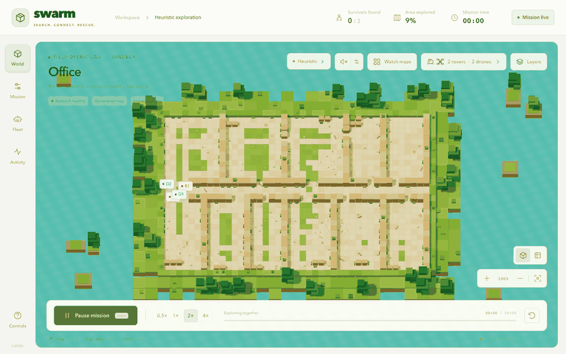

Recorded from the running React/Vite application in Chrome. Frames follow real
application ticks at 4× playback; discovery dialogs were continued through the
normal application action. GIF frames are downscaled and palette-encoded for
README delivery. Screenshot PNGs are saved at the original 1600×1000 viewport.

| Capture | Scenario | Fleet | What it shows |
| :--- | :--- | :--- | :--- |
| [Office overview](media/frontend/office-overview.png) | Office, seed 7 | 2 rovers + 2 drones | Initial generated world and mission controls |
| [Fleet inspection](media/frontend/office-fleet.png) | Office, seed 7 | 2 rovers + 2 drones | Paused step 12 and live agent telemetry |
| [Mine encounter](media/frontend/mine-team.png) | Mine, seed 17 | 1 rover + 3 drones | Actual discovery at step 6; the dialogue is fictional UI content |
| [Apartment mission](media/frontend/apartment-team.png) | Apartment, seed 23 | 3 rovers + 1 drone | Paused step 10 in another generated map |
| [PPO completion](media/frontend/ppo-completed.png) | Python rooms, seed 10000 | 2 rovers + 2 drones | Actual Python-backed mission, 4/4 found at step 94 |

<details>
<summary><strong>Open the office and apartment captures</strong></summary>

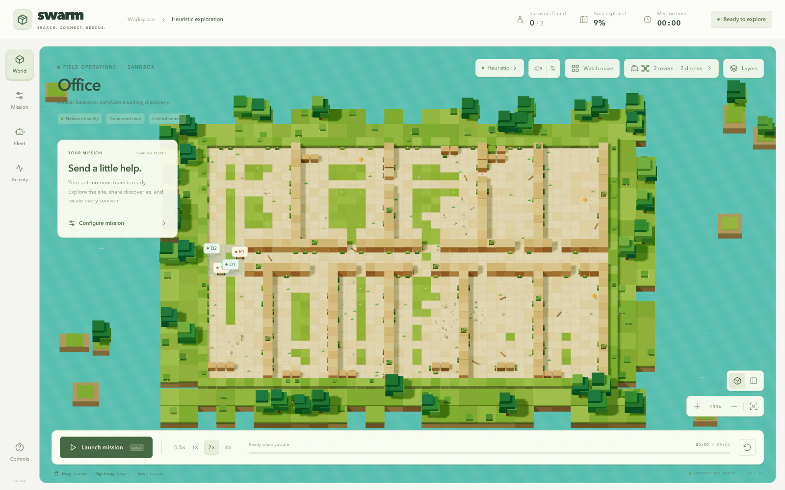
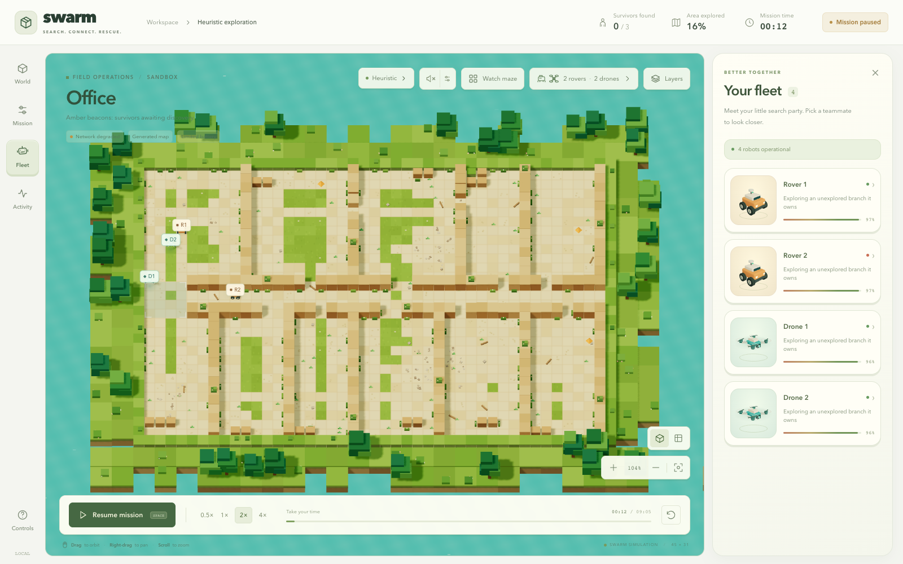
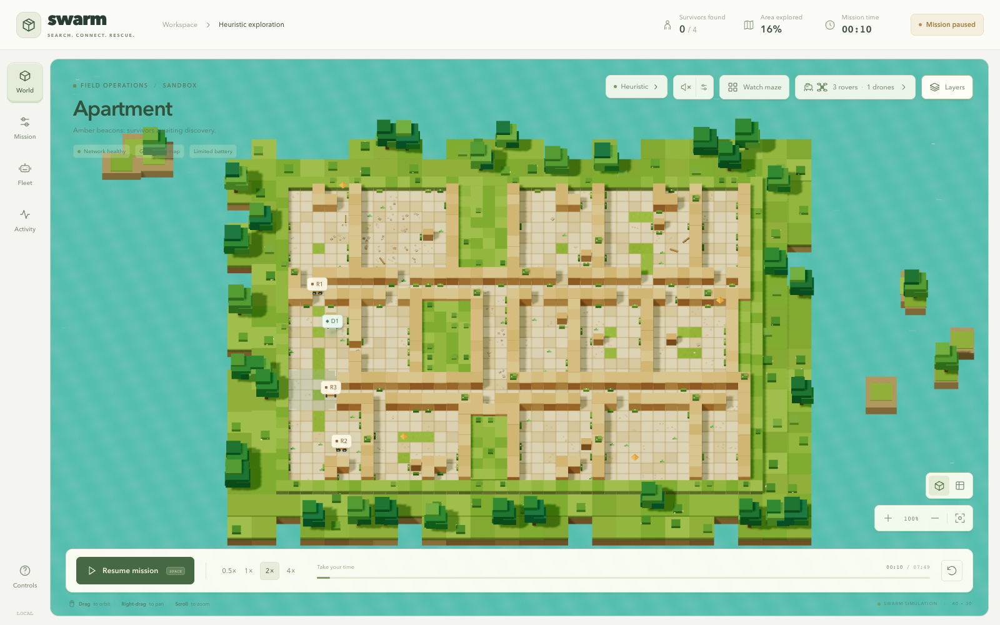

</details>

The heuristic examples demonstrate UI behavior and different generated browser
scenarios. They are not additional benchmark evaluations. The PPO example
reproduces one previously reviewed development episode.

Reproduce the captures with Vite on port 5173 and the backend on port 8765:

```bash
python -m pip install playwright Pillow
python docs/scripts/capture_frontend.py
```

The capture script uses installed Google Chrome. The manifest records viewport,
browser version, source hashes, robot positions, map seed, battery values,
mission step and coverage at capture time.

## Python 2D rollout

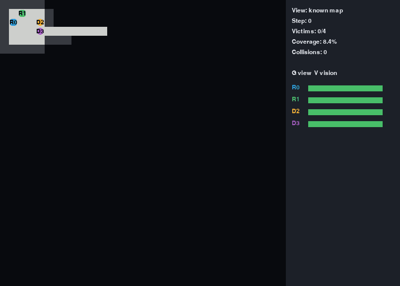

This existing Pygame recording uses the selected recurrent PPO policies and the
Python grid environment. Development seed 10000 ends at 94 steps with 4/4
survivors and 90.48% coverage. See the [recorded inference validation](validation/ppo_demo_validation.json)
and [viewer instructions](guides/ppo_demo.md). The renderer and browser provide
different views of the same grid-policy example; they are not separate benchmarks.

## Gazebo and RViz

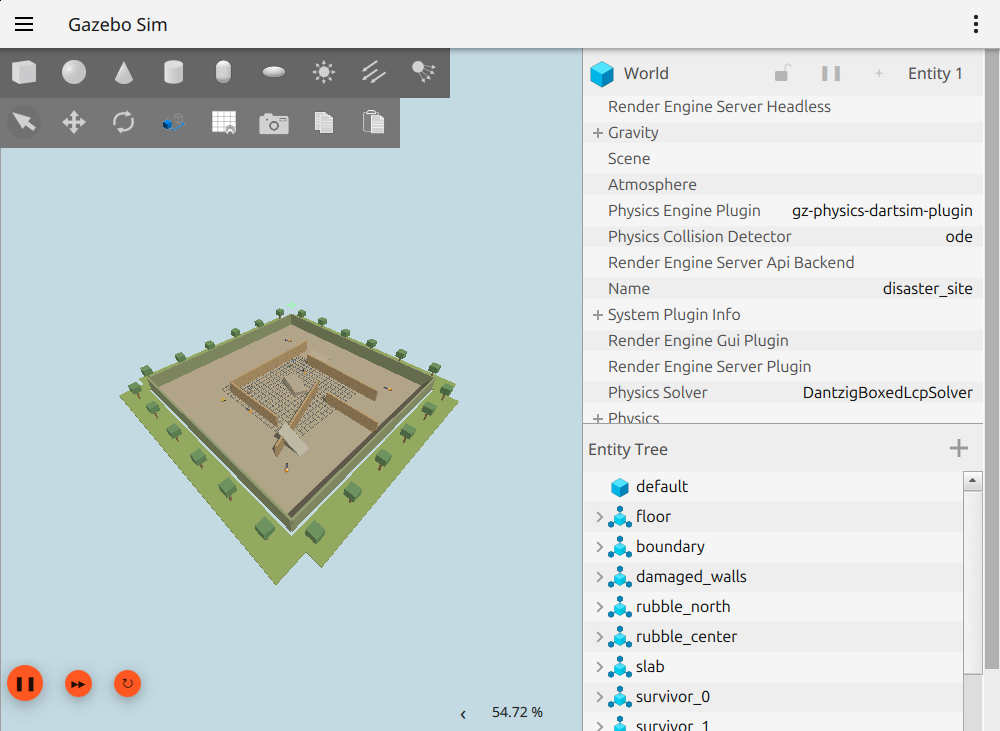
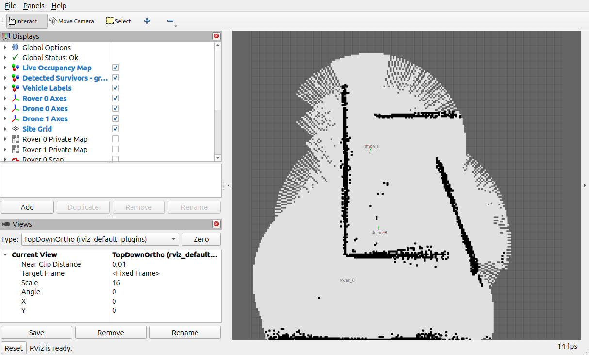

The supplied host screenshots are preserved byte for byte. They show one disaster
world with rover_0, drone_0 and drone_1. The original README and launch log identify
the host session as using loaded policy actors. This source checkout's default
ROS launch remains a waypoint-controlled physics demonstration. The supplied host
implementation is not included here, so that session's learned-policy integration
cannot be reproduced from the checked-in ROS packages alone.

The host log's rover/drone actor hashes start with `a6d62df2` and `49fbbd06`, while
the selected grid checkpoint's parameter hashes start with `3edcfc12` and
`8e1c10a6`. These records do not establish identical policies or interfaces.

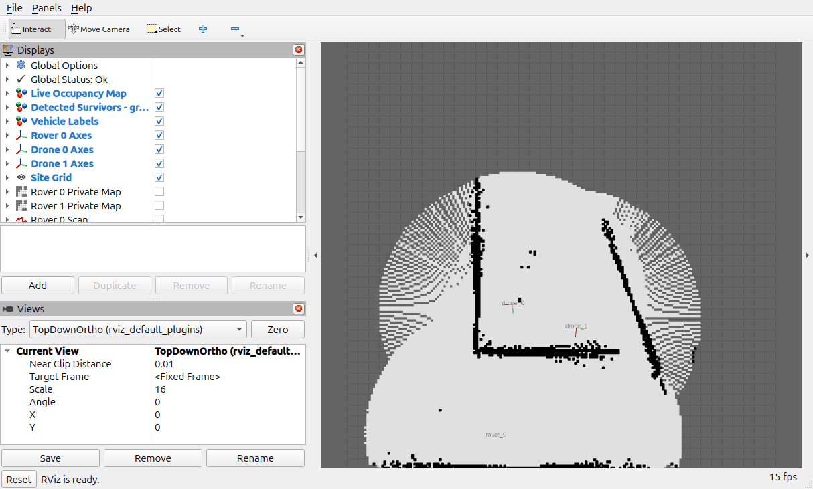

This GIF orders five original RViz screenshots. Playback timing is illustrative;
it does not reconstruct wall-clock timing. Camera-angle changes in the Gazebo
captures do not represent new maps, robot teams or completed missions.

| Evidence | Location |
| :--- | :--- |
| Original capture notes | [README](media/simulation-screenshots/README.md) |
| Supplied timestamps and camera positions | [Capture manifest](media/simulation-screenshots/capture-manifest.json) |
| Original ROS/Gazebo launch and policy-load log | [run.log](media/simulation-screenshots/run.log) |
| GIF source order and image hashes | [Sequence metadata](media/rviz-map-sequence.json) |
| Entire original archive | [simulation-screenshots.zip](media/simulation-screenshots.zip) |
| Checked-in physical demo instructions | [Physics guide](guides/physics_demo.md) |

<details>
<summary><strong>Additional original Gazebo camera views</strong></summary>

| West | Top | East |
| :---: | :---: | :---: |
| 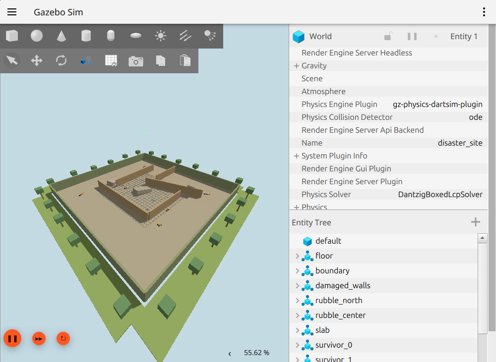 | 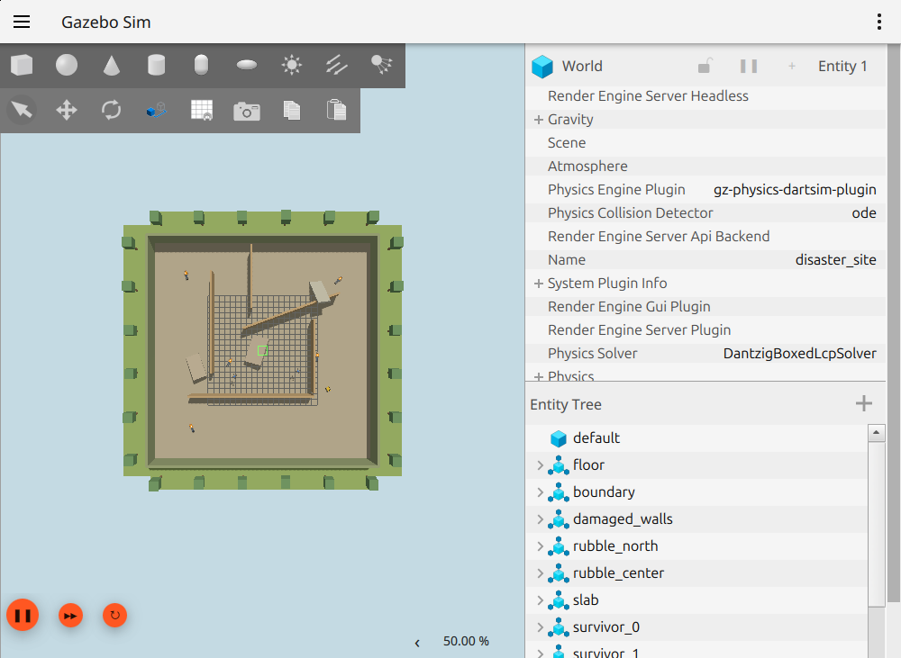 | 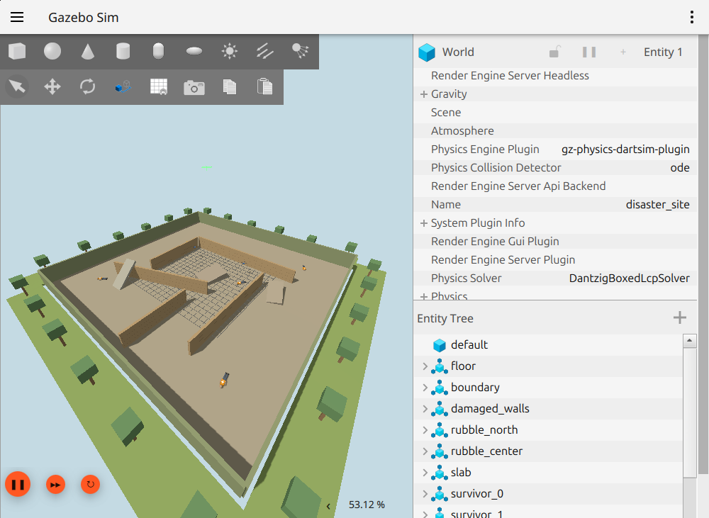 |

</details>
