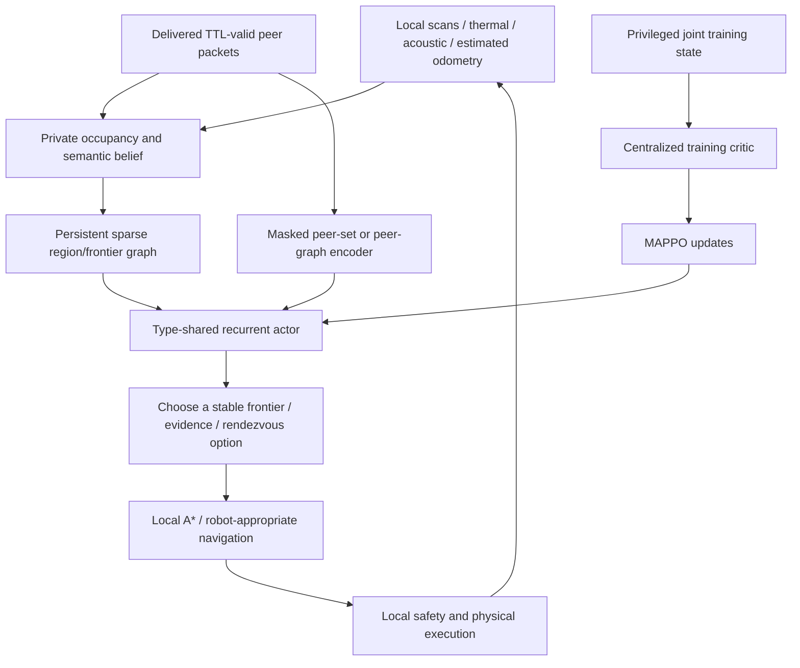

**Swarm SAR: a staged large-map MARL upgrade plan**

Prepared 30 October 2026 against the current project and Problem Statement 5.
Target progression: 64×64 → 96×96 → 128×128, keeping cell resolution explicit.
This is a proposed engineering and validation plan. No new policy was trained,
no new performance was measured, and sealed final seeds were not evaluated.
The accompanying `large_map_evidence_summary.json` only summarizes existing
development results.

**Recorded ROS learned-run evidence — clarification**

The supplied `docs/media/simulation-screenshots/run.log` records `ppo_agent`
processes, loaded rover/drone PPO actors, repeated policy decisions, live
occupancy maps and peer-network activity during a Gazebo/RViz session. It is
incorrect to describe all existing ROS work as waypoint-only. The current
checked-in launch defaults to waypoint control, and the matching `ppo_agent`
implementation is absent from the inspected local branches and remote-tracking
refs. Its actor hashes differ from the selected grid-policy handoff. Therefore,
first recover and reproduce the recorded host checkout, launch command and
model provenance. Do not rebuild an adapter until that existing work is audited.
The recorded learned run does not by itself establish SLAM or estimated-pose
localization: those require separate verification.

**1. The engineering decision**

Keep the deterministic simulator, PettingZoo interface, radio model, safety
rules, checkpoint provenance and browser. Build a versioned large-map path
with persistent spatial memory, better candidate coverage, goal commitment,
type-shared recurrent actors and a training-only centralized critic. Use
MAPPO as the first algorithm comparison, with a sparse graph/set encoder.
Continue to use conventional path planning and explicit local safety below
the learned search/cooperation decisions.

The complete proposed system is hierarchical graph-informed MARL with
centralized training and decentralized execution. MAPPO remains in the PPO
family; this proposal is not based on evidence that PPO as an optimizer is
the sole reason the current candidate fails. A centralized critic, graph
encoder and hierarchy solve different problems and must be ablated separately.

For this challenge, a repeatable learned-policy ROS mission, peer topology
exchange, sensor-based survivor localization and honest scalability evidence
are more useful than installing many algorithms or presenting an enlarged
browser map. GNN and collaborative SLAM are hints; they should be introduced
where the end-to-end system can support and validate them.

**2. What the existing evidence actually says**

Source: `models/ppo_754k/ppo_754k_review.json`.

| Recorded development outcome | Selected PPO | Paired expert |
|---|---:|---:|
| 56×56 maze survivors | 5/18 | 4/18 |
| 56×56 maze recall | 27.78% | 22.22% |
| 56×56 maze coverage | 19.15% | 33.66% |
| 48-cell tunnel survivors | 15/21 | 13/21 |
| Combined mean cohort recall | 88.80% | 87.13% |
| Rover hold fraction in maze cohort | 39.33% | 4.00% |

Five of eight PPO maze episodes reached 400 steps. Other endings need explicit
reason logging before being labelled battery failures. High hold counts are
a symptom to investigate; a hold may be necessary because of congestion,
no valid frontier or exhausted local options. They do not by themselves prove
policy collapse.

Code-confirmed constraints and the questions they create:

| Current constraint | Code | Consequence to investigate |
|---|---|---|
| PPO maze sampling is capped at size 32 | `learning/env.py` | The 56 maze is deliberately scale extrapolation. |
| 56 maze has a 400-step limit | `training/configs/evaluation_cohorts.yaml` | Travel/search budget may be insufficient even for a good controller. |
| Base rover/drone battery is 300/240 | `configs/robots.yaml` | Increasing the deadline alone may not extend effective range. |
| Policy sees a 9×9 crop plus five candidates | `sim/env.py`, `policy_contract.py` | Long-term spatial history and omitted branches are compressed heavily. |
| Path distance is clipped at distance/map-width ≥1 | `sim/env.py:observe` | Different long maze detours can look identical. |
| Peers are the first eight sender IDs | `sim/env.py:_peer_features` | A larger team can systematically omit useful peers. |
| Uncertainty grows per accepted movement; map merge threshold defaults to 4 | `sim/engine.py`, `sim/env.py` | Long missions can reject increasing amounts of otherwise delivered mapping data. |
| Candidate list is rebuilt and may reorder | `sim/env.py`, `sim/planning.py` | A slot is not a stable spatial goal identity. |
| A* has rubble cost 2 regardless of robot type | `sim/planning.py` | Drone route costs are inconsistent with its rubble energy cost 1. |

At base parameters, drone uncertainty grows by 0.015 per accepted move, so it
exceeds 4 after about 267 moves; rover growth 0.01 exceeds 4 after about 401.
Training randomization changes those values. The current map-merge checks both
sender and receiver uncertainty. This needs rejection-reason metrics and a
localization/registration solution; simply accepting arbitrarily uncertain
maps would manufacture false map quality.

There is also an information-boundary detail: the current immediate action mask
uses true other-robot positions for occupancy checks. The lower-level shield is
also simulator-informed. For a stronger decentralized claim, represent local
proximity sensing explicitly, derive actor masks from permitted local data,
and keep truth-based physics arbitration separately labelled. Test both the
actor inputs and mask, not just the neural-network vector.

**3. Diagnosis before an expensive training run**

Keep the original benchmark and checkpoint immutable. Add a new development
diagnosis suite with exact source, configuration, seeds and budgets recorded.
Use matched cases for the expert and policy. Do not open sealed final seeds.

Run the following experiments, initially on a small diagnostic cohort:

| Experiment | Change | What it can distinguish |
|---|---|---|
| D0 | Original budgets and controller | Reproduction and instrumentation reference. |
| D1 | More time, original energy | Deadline versus energy restriction. |
| D2 | More energy, original deadline | Energy versus time restriction. |
| D3 | Adequate time and energy | Remaining planning, perception and policy failures. |
| D4 | Stronger graph/utility expert, same budgets | Whether a useful teacher exists on large maps. |
| D5 | More/diverse candidates, paired controllers | Candidate omission versus candidate selection. |
| D6 | Radio enabled/disabled and partitioned | Communication benefit and failure modes. |

D1–D3 are diagnostic conditions, not improvements to the original benchmark.
Changed horizons also change mission-progress observations, so frozen-policy
behavior under them is an out-of-distribution diagnostic, not a clean causal
test of budget alone. Combine these runs with non-learning references and
offline physical feasibility bounds.

Log termination reason, per-agent remaining energy, feasible frontier count,
hold reason, goal switches, time without discovery, route revisits, repeated
shield interventions, collisions before/after protection, map-merge rejections,
message age and encoding saturation. Separate chosen hold from a shielded move.
Record whether the actor could even choose a promising branch.

Use full truth only in an offline diagnostic planner to compute optimistic
travel/energy lower bounds to survivor confirmation regions. A region is cells
within confirmation range with required line of sight, not necessarily the
survivor's own cell. A known-world planner can rule out some impossible cases;
it cannot prove that unknown-world exploration is feasible within the same
budget. Never put this oracle into policy observations.

**4. Define scale in resources, not just pixels**

A 64×64 grid has four times as many cells as 32×32; 128×128 has sixteen times
as many, at fixed cell resolution. Maze path lengths and bottlenecks need not
scale linearly with side length. More robots do not produce linear speedups in
a shared narrow corridor.

Create two labelled benchmark tracks:

- Fixed-resource track: identical fleet, energy and deadline across map sizes.
  This measures how the original resource envelope degrades.
- Operational scaling track: predeclared fleet/time/energy budgets based on
  map-family difficulty and mission capacity. Compare every controller under
  exactly the same scaled resources. Budget calibration uses training/development
  cases only and freezes before final evaluation.

Initial fleet ladder: 64 maps with four and eight robots; 96 with eight;
128 with eight and twelve. Twelve robots are a later scalability cohort, not
a prerequisite for the first 128-map success. With twelve robots, the current
eight-peer representation and ten-agent service UI must be versioned.

Choose budgets from reachable area, graph travel distributions, robot speed,
sensor footprint and expert feasibility. Do not silently multiply the deadline
by area and call the resulting score an algorithm improvement. More cells at
the same physical area are a resolution test, a different experiment.

**5. The target execution and training architecture**

During execution, no actor receives the global map, all survivor locations or
instantaneous teammate truth. The critic is training-only. Inference artifacts
contain the actor and its contract, and run with independent per-robot memory.
Tests must verify actor outputs are invariant to critic-only state changes.

The first spatial encoder should be a small, testable set/candidate scorer.
Compare it with sparse graph attention. A GNN is retained because it improves
paired results or satisfies a demonstrated spatial/communication need, not
because graphs are mentioned in the problem statement.

**6. Spatial memory and useful action choices**

Maintain a private graph of regions, junctions, dead ends, frontiers, evidence
sites and received peer claims. Nodes need stable IDs across updates. Useful
attributes include information gain estimate, route cost, estimated energy,
visit age, confidence, type traversability, evidence and peer claim/lease age.
Edges describe routes in locally known traversable space.

Avoid one dense attention node for every map cell. Use sparse local edges,
region compression and bounded active subgraphs. A starting experiment could
retain 64–256 active nodes and 16–32 actionable candidates per robot; these are
engineering starting points to profile, not validated optimum values.

Use spatial diversity and route-graph branches to prune candidates. Pure
Euclidean separation can confuse two parallel corridors behind a wall. Reserve
candidate capacity for underserved branches and evidence goals. Include explicit
continue/hold/investigate choices with well-defined semantics.

Score candidates with shared weights rather than treating slot number as a
fixed meaning. Padded candidates need masks and correct likelihood storage.
Candidate identities and the exact candidate tensor used to select an action
must be preserved in rollouts and BC labels.

Replace hard-clipped long path costs with features that preserve useful ordering,
such as log route cost plus energy/time feasibility ratios. Include message age,
goal progress, time since new evidence, revisits and whether a branch is already
claimed. Use data-derived normalization with versioned scales. Update distance
calculation to respect different rover/drone traversal and energy assumptions.

**7. Commit to useful goals, then add temporal hierarchy**

The project already chooses high-level frontier actions, but makes a policy
decision every one-cell step. Start by measuring and fixing unnecessary goal
switches, stale routes and bottleneck holds using stable goal IDs. Keep local
path replanning active when the map changes.

Next compare a high-level decision every few physical steps or at goal/blockage/
evidence events. The path follower and safety loop still run each physical step.
This can reduce the number of learned decisions required to traverse a large
map. Interrupt goals for strong new evidence, invalid routes, depletion and
explicit safety events.

This changes the learning time scale. For an option lasting d primitive steps,
accumulate discounted rewards and use discount gamma^d. Record duration and
termination/bootstrap flags. Simply reusing a per-step PPO loop while pretending
a 20-step route is one ordinary step gives an inconsistent objective. A first
implementation can use synchronized planning intervals; asynchronous per-agent
options need carefully specified buffers and credit timing.

The current gamma 0.995 assigns a reward 400 steps away weight about 0.135 and
1,600 steps away about 0.00033. Longer-horizon missions need a deliberate discount
and credit-assignment design. Raising gamma or memory length blindly is not an
adequate fix; compare the horizon, advantage variance and actual mission recall.

**8. MAPPO, heterogeneous actors and peer cooperation**

Retain separate rover/drone actors, or compare a shared backbone with explicit
type/capability features and separate heads. Do not train an independent model
for every robot. Preserve separate recurrent state for each agent and mission.

Introduce an agent-conditioned centralized value estimator trained on a pooled
joint state with live/dead masks, type, energy, progress and spatial summaries.
Train it without routing privileged features into the actor encoder. Start with
the existing actor observation held fixed so the critic's contribution can be
measured separately. Then add spatial/peer encoding and hierarchy in separate
experiments.

Replace the first-eight-ID peer flattening with a masked set/graph representation
and a documented bounded selection rule: task relevance, age, distance and
confidence. A GNN on the private map and a GNN over delivered peer information
are different components. For peer graph edges, use only actually delivered
information and known local relations. Several GNN layers must not manufacture
instantaneous multi-hop radio delivery.

Keep messages bounded: sender/sequence, frame, covariance, node/edge deltas,
evidence, goal claims and expiry. Use lease-based claims or distributed bidding
as a strong non-learning coordination reference. Rovers and drones should prefer
goals according to capability and energy, with behavior surviving missing peers.
Compare learned coordination against this strong reference; architecture names
alone do not establish useful collaboration.

For a later communication objective, evaluate rendezvous to exchange information
when isolation becomes costly. A robot should sometimes continue alone and
sometimes reconnect. Do not require every robot to remain permanently connected.
Learning compact payloads end to end is a separate research task; first retain
reliable, auditable semantic messages and learn how to use them.

**9. Reward and demonstration changes**

Keep confirmed survivors central. The current 0.02 reward per new cell can have
up to sixteen times the cumulative weight on a 128 grid compared with a 32 grid
of the same free-space fraction. Fixed coefficients can therefore change the
effective task preference as area increases.

Compare bounded/normalized team discovery shaping, confirmed-survivor reward,
time/energy cost and carefully limited stall penalties. Reward a coordinate
once per team, not once per robot or packet. Never reward sensor noise spikes,
repeated false investigations or retransmitting the same cells. If potential
shaping is used, implement duration-aware discounts and terminal potentials
correctly; do not claim a policy-invariance guarantee for arbitrary added bonuses.

Keep hold available when necessary; blanket hold penalties can force useless
or unsafe movement. A penalty for a sustained avoidable stall should depend on
valid alternatives and distinguish voluntary behavior from the safety layer.

Collect new expert trajectories on the new map distribution only after the
expert is useful there. Fix teacher dependence on unencoded ownership/identity
memory by encoding legitimate local role/ownership context or simplifying the
teacher. Then use BC warm start, closed-loop evaluation and PPO/MAPPO practice.
If error accumulation is substantial, consider DAgger-style expert relabeling on
learner-visited states, using the same permitted information and seed discipline.
Original 229-input weights are not plug-compatible with a new graph contract.

**10. Open-source components: what to reuse and how**

| Component | Intended use | Integration boundary |
|---|---|---|
| [MARVEL](https://github.com/marmotlab/MARVEL) | Multi-robot graph-attention exploration and informative action pruning reference. | Reproduce its supplied example separately, inspect the graph/model, port useful ideas to our private-map interface. It is not an off-the-shelf heterogeneous SAR policy. |
| [IR²](https://github.com/marmotlab/IR2-Multi-Robot-RL-Exploration) | Hierarchical exploration under sparse intermittent connectivity. | Reference for reconnect-versus-explore behavior; adapt to our packet/TTL/thermal/acoustic contracts. Its old tested dependency stack needs isolation. |
| [MAPPO reference](https://github.com/marlbenchmark/on-policy) | Actor/centralized-critic separation, masks and rollout/update semantics. | Use as algorithm reference and controlled baseline. Its default all-agent parameter sharing needs adaptation for our two types. |
| [Ray RLlib](https://docs.ray.io/en/latest/rllib/rl-modules.html) | Keep the existing collection/training/serving infrastructure first. | Add versioned modules and critic inputs compatible with the project's pinned Ray/PyTorch versions. |
| [PyTorch Geometric](https://pytorch-geometric.readthedocs.io/en/latest/generated/torch_geometric.nn.conv.GATv2Conv.html) | Sparse map/peer graph layers if graph ablations justify them. | Alternatively use plain PyTorch attention/set pooling first. Confirm installed Torch/CUDA wheel compatibility. |
| [BenchMARL](https://github.com/facebookresearch/BenchMARL) | Independent IPPO/MAPPO/other controlled algorithm comparisons. | A custom environment/task and group/state adapter is still required. Optional experimental harness, not an automatic migration of RLlib checkpoints. |
| [Nav2](https://github.com/ros-navigation/navigation2) + [SLAM Toolbox](https://github.com/SteveMacenski/slam_toolbox) | Rover local navigation and estimated 2D mapping/localization in ROS 2. | Robot namespaces, TF, sensors and map-to-odom transforms must be configured. They do not by themselves solve multi-robot registration or drone 3D navigation. |

MARVEL's README describes decentralized graph-attention multi-robot exploration;
IR² addresses communication tradeoffs with attention and hierarchical graphs.
These are the closest research references to the challenge, rather than generic
pretrained vision/language models. Their published outcomes are not predictions
of outcomes in Swarm SAR. Check and retain each component's license/attribution
when copying code; MARVEL is MIT and the inspected IR² repository is Apache-2.0.

Reuse process: pin source commits → create isolated upstream environments →
reproduce an upstream example → document sensor/action/task assumptions → wrap
or port the selected component → validate contract and information boundaries →
retrain for our rescue objective → run paired development comparisons → deploy
the exact verified actor. Installations alone do not confer the upstream result.

[ARiADNE's ROS planner](https://github.com/marmotlab/ARiADNE-ROS-Planner)
is useful for graph waypoint/ROS integration patterns, but is single-robot 2D
exploration. Its repository advertises a ROS 2 Humble branch; that is not proof
of compatibility with our recorded Lyrical/Gazebo 10 host. MAANS/Active Neural
SLAM are useful hierarchical references but bring different visual sensors,
map assumptions and older dependencies. Do not rebuild the project around them
as the first hackathon action.

[VMAS](https://github.com/proroklab/VectorizedMultiAgentSimulator) provides
vectorized PyTorch 2D simulation and is worth considering only after profiling
shows rollout throughput is the bottleneck. Porting this project's grid,
occlusion, sensors, communication and deterministic contracts is substantial
work. Gazebo/Isaac migration also changes the experiment, rather than merely
making our current environment run faster. Keep Gazebo for the existing ROS
proof before adding another simulator.

**11. Curriculum and experiment ladder**

| Stage | Maps and teams | Main question | Exit evidence |
|---|---|---|---|
| A: diagnosis | Existing 32/40/56 plus new 64 development cases | What fails under matched resources? | Reason-coded failure report and feasible resource specification. |
| B: strong 64 | Mixed 32/48/64; four and eight robots | Do better memory/candidates/goal persistence help? | Reliable expert, a learned closed-loop improvement and no small-map regression. |
| C: cooperative 64–96 | Mix 48/64/80/96; four/eight robots | Does CTDE and permitted peer information improve coordination? | Paired critic/communication/memory ablations and partition resilience. |
| D: 128 extrapolation | Freeze a candidate trained through 96; evaluate untouched 128 development maps | Does the design extrapolate? | Labelled size-extrapolation report with failures preserved. |
| E: trained 128 | Mix 32–128; eight robots first, twelve later | Can we learn robust 128 behavior? | New independent-map evaluation; no longer call 128 an unseen training size. |
| F: ROS transfer | Small matched ROS mission, then larger geometries | Does the exact actor work through estimated sensors and physical execution? | Checkpoint identity, traces, localization/detection metrics, complete mission recording. |

Mix easier maps throughout, for example 20–30% small maps as a starting curriculum
choice, to detect forgetting. Progress by measured behavior rather than a fixed
number of overnight jobs. Curriculum percentages and sequence lengths must be
tuned as experiments, not treated as known answers. Trial 32/64/128 recurrent
training windows with burn-in if memory diagnostics justify the extra cost.

The historical 56 maze is already development data. If its scale enters training,
retire the old extrapolation label. New final cases need disjoint seed ranges,
generator/version records and held-out layouts. A small number of repeatedly
selected seeds must not become the only definition of success.

Minimal ablation ladder: original policy → matched budget diagnostic → improved
planner/candidates without learning → recurrent local actor with richer memory →
same actor with centralized critic → peer/map graph encoder → temporal hierarchy.
At an advanced stage compare communication off/on, stale-message controls,
peer-order permutation and three independent training runs (five if affordable).
Match total simulator steps and report wall time for algorithm comparisons.

**12. Acceptance criteria and what would count as strong**

The following are proposed development targets for predeclared operational
budgets, not expected scores or achieved results:

| Metric | 64 target | 96 target | 128 target |
|---|---:|---:|---:|
| Survivor recall | ≥95% | ≥90% | ≥85% |
| All-survivor completion | ≥90% | ≥85% | ≥80% |
| Invalid actions | 0 | 0 | 0 |
| Post-safety overlap | 0 | 0 | 0 |
| Paired recall regression versus expert | None beyond predeclared tolerance | Same | Same |

Require a measured benefit beyond matching the expert, such as faster discovery
at matched recall, better worst-cohort recall or lower duplicate travel, with
paired uncertainty. Report worst cohorts separately. A practical proposed gate
is at least 75% recall in every feasible stress cohort, with the cohort sample
size and uncertainty shown. Revise feasibility/budgets openly before freezing,
not after seeing final outcomes.

Start with 30–50 independent development maps per principal size and several
layouts, then expand promoted candidates. Keep a smaller fixed smoke subset
for engineering; it is not the final performance report. Bootstrap paired
episode-level differences and distinguish training-seed variability from
environment-seed variability. A release protocol should evaluate the frozen
candidate on at least 100 independent final maps per principal size if compute
permits, without using those results for another selection cycle.

Also log time-to-first survivor, censored time-to-all survivors, route efficiency,
duplicate visited cells, useful discoveries per joule, bytes per useful discovery,
uncertainty/registration failure, policy/step latency percentiles and safety
interventions. Coverage is diagnostic; do not penalize a valid early rescue
completion for leaving irrelevant corridors unmapped. Measure complete-map
coverage in a separate fixed-budget survey task when desired.

Zero collisions must retain the safety-layer qualifier. Predicted survivor
positions need localization error and false-positive/false-confirmation metrics,
not only the grid environment's count of truth-confirmed victims.

**13. End-to-end ROS and GPS-denied applicability**

Use the ROS stack already present before attempting another simulator. Create a
versioned sensor-to-policy adapter: scan/estimated occupancy and odometry → the
same actor contract → frontier/evidence target → rover Nav2/local planner or
drone-appropriate local controller. Maintain separate recurrent state, frame
identity and timestamped message buffers for every robot.

Train on the local representations available in deployment and randomize their
errors. Directly deploying a policy trained on truth-indexed grid beliefs can
fail even when its vector dimensions match. Compare a truth-localization
diagnostic mode with estimated-localization mode and label both.

Start with a known relative starting frame and one rover plus one drone. Then
use two plus two and larger layouts. SLAM Toolbox can supply rover map/odom
estimation, but collaborative SLAM also needs cross-robot frame alignment,
validated loop closures or relative measurements, and uncertainty-aware map
fusion. Do not reset uncertainty numerically without a simulated/real
localization observation that justifies the correction.

Give survivors an estimated semantic location with covariance, supporting
thermal/acoustic evidence, source robot and timestamp. Use simulator truth only
to evaluate location error and false positives. Preserve our synthetic sensor
scope unless a calibrated model or hardware test is actually added.

The current waypoint launch remains a useful physics regression profile. Add a
separately labelled learned launch with the exact candidate hash and interface
version. A valid recorded mission should show unknown map growth, an actual
learned search choice, peer data transfer, sensor evidence and a confirmed
estimated survivor marker through the same execution path.

**14. Files and contracts for implementation**

Proposed paths, not files already implemented:

| New component | Proposed location | Existing code to reuse or audit |
|---|---|---|
| Failure analysis | `simulation/scripts/diagnose_large_maps.py` | Metrics, cohort reconstruction and episode logs. |
| V2 contract | `simulation/src/swarm_sar/policy_contract_v2.py` | Existing contract hashing and mask checks. |
| Large-map environment | `simulation/src/swarm_sar/sim/env_v2.py` | Core physics/sensors; explicit candidate/option semantics. |
| Persistent task graph | `simulation/src/swarm_sar/mapping/task_graph.py` | Private topology and frontier/planning helpers. |
| V2 actor/critic | `simulation/src/swarm_sar/learning_v2/` | Existing inference, cloning and release patterns. |
| New configs/cohorts | `training/configs/large_map_v2/` | Keep historical configs and sealed definitions unchanged. |
| Versioned service | `backend/ppo_service_v2.py` | Session identity, idempotent steps and provenance checks. |
| Protocol/UI scaling | `frontend/src/ppo/`, scene/store files | Explicit runtime labels, new map/team limits and delta state. |
| Learned ROS adapter | `swarm_sar_control/.../learned_agent.py` | Existing ROS messages, models and transport. |
| Validation | `tests/large_map_v2/` | Leakage, graph/action identity, recurrent state, resources, reproducibility. |

Build v2 alongside the audited baseline. Do not change the existing 229-value
contract and call old weights compatible. Record new source/config/model hashes.
For a graph policy, raw ONNX export may require special handling; CPU PyTorch
inference remains a reasonable first serving path.

**15. Profile scalability before spending on compute**

The simulator performs frontier extraction, route searches and map processing on
CPUs. Profile per-step time by world size, robot count and component. A larger
GPU will not accelerate Python graph generation by itself.

Prioritize dirty-region frontier updates, belief-version route caching,
avoiding full-map padding for every 9×9 crop, bounded topology updates, spatial
radio lookup and batched per-type actor inference. Keep deterministic RNG and
sensor semantics intact while optimizing. Measure p50/p95 step time and actual
environment steps per second before and after each change.

Budget snapshots also matter: sending every robot's full 128×128 belief on
every HTTP step grows as robots × map area. Use versioned map deltas and periodic
snapshots, preserving reset/retry correctness. Use chunked/instanced scene
rendering and separate render rate from policy/physics rate.

CPU-only machines can do diagnosis and small validation. One CUDA GPU in roughly
the 16–24 GB class plus enough CPU/RAM is a reasonable starting workstation to
profile for the proposed compact models, not a verified requirement. More
machines mainly help independent training seeds and cohort evaluation after
throughput is measured. Do not promise a number of hours from GPU model alone.

Compute forecasts should come from a measured pilot: if the whole training
system sustains R joint environment steps/sec, B steps cost approximately B/R
seconds plus evaluation, I/O and interruption time. Options may change the
number of actor decisions, so report primitive world steps as well.

**16. Hackathon priorities and team execution**

Suggested workstreams, to agree with the team rather than claims about past
ownership: Om—contracts/learning/evaluation; Yash—ROS/localization/inference
adapter; Purva—planning/peer data and tests; Pankti—frontend/telemetry/evidence.
Reassign according to actual strengths. All four should share the architecture
and exact claim boundaries.

Priorities in order:

1. Produce a trustworthy failure report and a feasible large-map benchmark.
2. Demonstrate a working 64 learned mission and a repeatable ROS learned path.
3. Show measured value from richer spatial memory and peer cooperation.
4. Promote through 96 to 128 with frozen, independently generated evaluations.
5. Expand fleet size and collaborative localization only as validated components.

If only 24–48 hours remain, prioritize diagnosis, goal/feature fixes, feasible
64 cases and the smallest learned ROS integration; show 128 as an honestly
labelled stress test if it is not ready. With several days, add the v2 encoder,
CTDE comparison and measured 96/128 pilots. A fuller graph/hierarchical policy
and collaborative localization are larger work packages, often requiring
multiple iteration cycles. These are scope choices, not elapsed-time promises.

The final demonstration should use one displayed scenario/configuration ID,
an exact checkpoint identity, private robot views, delayed/lost peer updates,
sensor evidence, estimated survivor markers and a replayable report. Keep the
scale plots beside a live failure/partition scenario. Do not relabel heuristic
fallback or waypoint motion as learned search.

The first implementation deliverable should therefore be a diagnosis and
benchmark package, followed by the smallest v2 policy that demonstrably helps.
That gives the team a measurable route to a stronger system without committing
all remaining time to a speculative rewrite.
