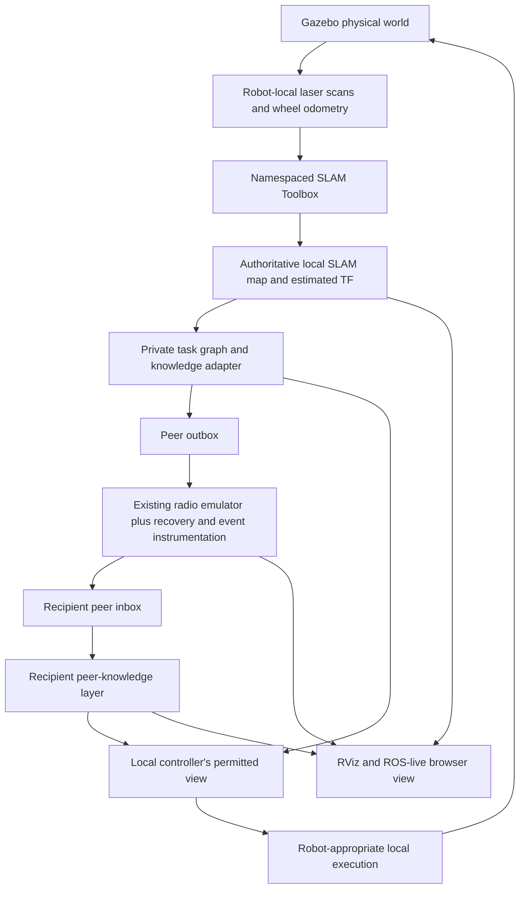

**SLAM and agent-to-agent communication: focused integration plan**

Prepared 30 October 2026. This is the active plan for the overnight window before
the approximately 2 PM IST presentation on 31 October. The immediate scope is
SLAM, useful peer exchange and truthful visualization of physical simulation.
Training and the larger-map architecture are separate workstreams, not
prerequisites for this integration. Features below are proposed unless explicitly
described as existing.

**Branch/PR audit:** The main ROS implementation is already present here,
originating from Yash's merged `ubuntu_simulations` PRs #1/#2. All 35 files
from that branch are retained. See the
[verified branch/PR/media audit](../audits/ros_branch_pr_audit.md). Only the
specific PPO host-controller variant shown in the supplied recording remains
unlocated in the inspected Git refs; it is not necessary to re-import the whole
ROS workspace before SLAM development.

**1. The demonstration we are building toward**

A rover estimates its pose and map from simulated laser scans and odometry.
Agents exchange map/topology changes, evidence and goal claims through the
existing impaired-radio transport. A selected robot's view clearly distinguishes
its own observations from information accepted from peers. During isolation it
continues locally; after reconnection it can recover missed information. Gazebo
shows physical motion; RViz and the browser show actual ROS state.

Tonight's minimum release keeps the existing one-rover/two-drone team: run 2D
SLAM on the rover and exchange legitimate observations/evidence with the drones.
Two independently SLAM-enabled rovers are a second milestone requiring a
separate fleet profile. Do not treat elevated drone laser scans as equivalent
to ground-rover scans; full drone 3D localization is outside this first release.

The recorded ROS host run already logs PPO actors and policy decisions. Retain
that implementation on its actual host and apply the mapping interface changes
there when available. This plan does not assume the learned ROS work must be
rebuilt. The selected grid checkpoint, current local launch and recorded host
actor identities remain separate until verified against the running checkout.

**2. Keep these four responsibilities separate**

| Component | Owns | Must not be mistaken for |
|---|---|---|
| Gazebo | Simulated bodies, contact, sensors and physical ground truth | The robot's estimated knowledge |
| SLAM Toolbox | Estimated planar map/pose corrections from scans and odometry | A detector of survivor identity or a complete multi-robot registration solution |
| Per-agent knowledge/communication layer | Private beliefs, received information, claims and evidence | An omniscient shared-memory map |
| RViz/browser | Operator visualization of published state | A second simulator or a source of privileged robot inputs |



The simulator may use truth for sensor/radio emulation and offline evaluation.
Controllers and peer knowledge must use permitted estimated observations. An
operator display may see several robot maps but cannot broadcast that combined
operator view back as if it were a peer packet.

**3. What exists, and where the new work belongs**

Existing: robot models and sensor bridges; per-robot scan/odom/status/evidence
topics; `PeerMessageEnvelope`; peer inboxes/outboxes; range/loss/wall/delay/expiry
transport; private occupancy mapping; RViz map tiles and survivor markers; a
React/Three.js mission frontend with network and map presentation components.

The inspected ROS receiver copies peer grid indices directly into its grid,
does not explicitly validate receiver-side expiry/deduplication/frame alignment,
and retains peer claims beyond their useful life. The sender removes cells
from its dirty set on broadcast; a dropped update has no periodic snapshot
recovery in that ROS path. The Python grid transport has stronger recovery
features, but that does not automatically make them present in ROS.

SLAM makes those details consequential: occupancy map origin/size can change,
and map optimization can invalidate old spatial information. This integration
must fix coordinate/revision handling rather than attach SLAM to the existing
raw-index map merge.

The current `frontend/src/ppo/RemoteEngine.ts` validates a particular 754k grid
checkpoint and 24–56-cell square worlds. It is not a ROS data adapter. Add a
separate ROS-live data model and view rather than weakening that validator or
pretending ROS poses are grid-simulator ticks.

**4. Phase A: establish one correct SLAM pipeline**

On the actual Linux ROS host, inspect the installed ROS/Gazebo versions,
SLAM Toolbox executables, scan stream and TF tree. Prefer compatible installed
packages; do not replace the whole ROS distribution tonight.

```bash
ros2 pkg executables slam_toolbox
ros2 topic hz /rover_0/scan
ros2 topic echo /rover_0/wheel_odom --once
ros2 run tf2_tools view_frames
```

The current launch publishes static `map -> rover_0/odom`, while the robot model
also publishes world-pose odometry/TF. SLAM needs ownership of its estimated
map/odom relation. In a new optional profile, choose one consistent chain:

```text
rover_0/map -> rover_0/odom -> rover_0/base_footprint -> ... -> rover_0/lidar_link
    SLAM         estimated wheel/odometry TF             robot description
```

Disable or isolate conflicting world-pose TF and static map/odom publishers in
that profile. Bridge the wheel TF where needed, or provide one tested odometry
TF publisher. Verify frame conventions and spawn origins. Do not publish two
different odometry estimates under the same TF relation. Keep ground-truth
odometry on a separately labelled diagnostic topic if used for evaluation.

Configure real topic/frame names, `use_sim_time`, scan range and map resolution.
Start around 0.10–0.20 m/cell as a workload experiment for the existing world,
not a calibrated optimum. The existing map rendering workaround can draw
SLAM occupancy cells if the host's native RViz map shader still fails.

First move through a short repeatable route or controlled teleoperation. That
validates mapping independently of search decisions. Then feed the estimated
map/pose to the active controller adapter. Label a waypoint/teleop mapping run
as such until the learned or autonomous controller actually consumes estimates.

Pass A when: map grows from scans, timestamps and TF remain fresh, an estimated
trajectory can be recorded, a map can be saved, and a clean restart reproduces
the behavior. A loop closure is claimed only if an actual event is observed.
Applying a numerical uncertainty reset is not a localization measurement.

**5. Phase B: separate local SLAM from received knowledge**

Maintain three explicitly different products:

| Product | Contents | Consumer |
|---|---|---|
| Local SLAM map | Own sensor-derived occupancy and SLAM corrections | SLAM/localization and local mapping |
| Peer knowledge layer | Accepted map patches, graph changes, claims and evidence with provenance | Local planning/coordination adapter |
| Operator combined view | Selected or overlaid views for a human | RViz/browser only |

Do not overwrite the SLAM map by inserting arbitrary received cells, or feed
occupancy patches into SLAM as invented laser scans. A planning view may combine
known local and accepted peer information, with a documented conflict policy
and source labels. Unknown stays unknown; stale observations retain age.

For the first map-sharing version, use known relative starting poses in the
staging area as an explicit initialization assumption. Independent SLAM maps
cannot be merged by matching array indices. Send metric positions, resolution,
origin/orientation, source frame and revision. Transform at the observation
timestamp using a known/estimated inter-map relation; otherwise defer or reject
the spatial merge. Matching frame-name strings is not proof of registration.

On loop closure, map resizing or origin change, update the source map revision
and reproject/invalidate affected cached information. Receivers must reject
incompatible deltas and request a consistent snapshot. First-night fallback:
publish a new versioned snapshot rather than trying to implement a sophisticated
incremental pose-graph deformation protocol.

Start with topology and evidence exchange if reliable occupancy registration
is not yet available. Retain unaligned observations as source-frame records,
not confidently aligned receiver map cells.

**6. Phase C: improve the existing agent-to-agent transport**

Reuse `PeerMessageEnvelope` and its sender/target/sequence/expiry/pose fields.
Keep new content versioned in `payload_json` initially to avoid unnecessary
interface churn on the installed host. Add run identity, schema version,
frame/map revision and per-kind payload validation.

Priority changes:

1. **Receiver validation:** sender identity, well-formed finite payload,
   message ID deduplication, expiry and a valid frame/revision. Prevent older
   goal state from replacing a newer claim. Handle simulation-time reset with
   a new run ID and cleared queues/caches.
2. **Claim leases:** release peer frontier claims on expiry, explicit release
   or newer information. Expired peers must not reserve a branch indefinitely.
3. **Loss recovery:** retain a bounded latest map/graph state and send periodic
   snapshot chunks or respond to resynchronization requests. Do not depend on
   a one-shot dirty-cell broadcast surviving the channel.
4. **Structured telemetry:** emit per-link send/queue/drop/publish events, plus
   receiver accepted/rejected events and reasons. A bridge publishing to an
   inbox is not proof that the receiving agent applied the data.
5. **Controlled partitions:** add an actual isolate/reconnect control in the
   transport, with explicit semantics for queued packets and sim-time duration.
   Agents still receive their own sensors and continue their local loops.
6. **Bandwidth and priority:** the inspected ROS bridge does not enforce a byte
   budget. Add a bounded per-sender queue/token budget, count serialized payload
   bytes, prioritize evidence and claims, and chunk/defer map snapshots fairly.
   Label measured serialized bytes separately from real DDS/RF wire overhead.

For the first visual demo, use normal conditions, configured 30% loss with
existing approximately 100–300 ms delay, and a 15-simulated-second isolation.
These are proposed test settings. Preserve the existing runtime's actual
defaults and record every applied override.

Payload kinds should cover:

| Kind | Minimum useful data |
|---|---|
| `pose_status` | Estimated pose, uncertainty/source, stamp and capability |
| `frontier_claim` | Stable goal/node ID, metric goal, source frame, lease expiry |
| `topology_delta` | Node/edge changes, source graph revision, route/visit/evidence attributes |
| `survivor_evidence` | Signal values, estimated position/frame, source and confirmation status |
| `map_chunk` / snapshot | Source resolution/origin/revision, chunk identity and bounded observed cells |
| `resync_request` | Missing or incompatible source revision |

Extract real region/frontier/junction topology from estimated/private occupancy.
Use stable source-local node identities and revisioned updates. A centrally
drawn truth graph is not peer topological sharing. Goal separation and task
leases can use this received topology before any new GNN is introduced.

Leave multi-hop relaying as a later extension. It needs origin IDs, duplicate
suppression, hop limits and end-to-end expiry so packets cannot circulate.
More visible direct communication and reliable recovery are the first release.

**7. Collaborative SLAM is a separate promotion gate**

The inspected current upstream SLAM Toolbox documentation includes a
decentralized multi-robot node using localized scan exchange. Check whether
the installed release actually contains it. Its documented setup requires
known starting positions and a shared reference odometry frame.

If available and single-rover SLAM is stable, test two rovers in an optional
profile. Route the shared localization data through the intended communication
path if claiming radio-constrained collaborative SLAM. A direct DDS share topic
must not silently bypass our emulator. Separate ingress and egress or a tested
adapter is necessary to prevent relay loops; do not republish incoming peer
traffic into the same outbox indiscriminately.

Distinguish the resulting claims:

- Single-rover SLAM plus peer evidence/topology sharing.
- Multiple independent SLAM instances plus registered map sharing.
- Collaborative SLAM with actual inter-robot constraints in pose estimation.

Only claim the level demonstrated. Two independent maps unioned for display
do not by themselves establish collaborative pose-graph optimization.

**8. How to show physical simulation: Gazebo and RViz first**

Gazebo remains the physical scene. Show the rover moving and drones operating
in the existing disaster site. RViz shows the selected robot's estimated map,
laser returns, estimated trajectory, task graph, current goal and received
survivor evidence. Add communication markers driven by real transport events.

Use these display meanings:

| Visual | Meaning |
|---|---|
| Gray / white / dark occupancy | Unknown / observed free / occupied |
| Blue or cyan overlay | Information accepted from a peer, with source/age |
| Amber evidence marker | Suspected location |
| Green evidence marker | Confirmed observation under the current sensor rules |
| Graph nodes and edges | Actual private/received topology, not decorative connectivity |
| Link and packet pulse | Link state and actual packet events, labelled separately |

Pulse a packet at recorded send/arrival events. Link health alone must not
create fictitious deliveries. During isolation, display missing updates and
claim expiry. After recovery, highlight receiver-applied changes. A confirmation
marker must be driven by evidence, not preloaded world survivor coordinates.

Record the source of each pose. Rover SLAM estimates and drone simulator flight
feedback are different. Elevated drone rendering does not demonstrate 3D SLAM.
Do not display an invented localization-confidence percentage; use actual
covariance when supplied and clear freshness/status fields otherwise.

The current `disaster_scene.py` map-tile renderer already follows OccupancyGrid
origin/resolution and message frame. Parameterize its input instead of replacing
it. Update survivor-marker handling, which currently assumes a literal `map`
frame, to perform explicit valid transforms or reject an untransformable report.

**9. Put the same ROS data in the existing browser**

Add an explicit **ROS Live** mode alongside the existing modes. Use the existing
React/Three.js visual language, but separate the ROS state model from the grid
engine. Gazebo/ROS owns all movement; browser interpolation is presentation only.

Recommended bridge: `rosbridge_suite` on the ROS host and a compatible `roslibjs`
client or a small typed WebSocket adapter in the frontend. This exposes ROS
messages to the browser; it does not turn peer radio communication into a
centralized planner. Browser subscriptions are operator observability, not a
way for robots to bypass inboxes.

Start with a 2D estimated map and telemetry panel. Reuse robot model geometry
for a 3D ROS view only after frame/metric handling is correct. If rendered,
the scene is a visualization of ROS state, not a second execution of the
browser simulator and not the Gazebo GUI itself.

Suggested screen layout:

```text
ROS LIVE | sim time | connection | pose/map source
+--------------------------------+--------------------------+
| Estimated map / 3D ROS view    | Selected agent           |
| Own map + peer overlay         | scan / TF / map freshness|
| Robots, paths, topology        | evidence and goal        |
+--------------------------------+--------------------------+
| A -> B message events          | Link statistics          |
| sent / received / applied      | drops / age / byte counts|
+--------------------------------+--------------------------+
| Robot view selector | Isolate / reconnect | Record / export|
+-----------------------------------------------------------+
```

Map updates can start at 1–2 Hz and robot-pose display around 10 Hz, while the
renderer runs independently. Use OccupancyGrid origin, rotation and resolution;
never assume one cell is one metre. Stream bounded events/deltas and periodic
snapshots, not complete maps at every rendered frame. On connection loss, mark
the data stale and stop animating predicted robot progress. On a new simulation
run, clear previous maps, packets, markers and trajectories.

Include robot-private and operator-combined views with clear labels. Network
controls should call the actual simulation transport configuration; a changed
line color is not a partition. Initially the browser can be read-only, with
partition controls operated in ROS until their service path is tested.

The local site serves through Vite/the ROS host or a documented tunnel. A public
website cannot directly reach a private Linux VM WebSocket without configured
network connectivity; do not make hosted publication a dependency for the demo.
RViz remains a complete fallback if browser bridging is unfinished.

**10. Proposed topics and files**

Names below are a proposed contract to implement, not existing topics:

| Topic | Purpose |
|---|---|
| `/rover_0/slam/map` | Local sensor-derived OccupancyGrid |
| `/rover_0/estimated_pose` | Adapter output from the estimated TF chain |
| `/rover_0/belief_map` | Local planning/knowledge view including accepted peer layer |
| `/rover_0/topology` | Versioned private topology export |
| `/<agent>/peer_outbox`, `/<agent>/peer_inbox` | Existing impaired-communication boundary |
| `/swarm/network/events`, `/swarm/network/stats` | Actual per-link transport and receiver outcome telemetry |
| `/swarm/mission/evidence` | Frame-aware operator evidence display |

Existing TF, clock and scan topics remain part of the recording. Namespace all
additional robots consistently; align QoS for late map subscribers and sensor
streams. Discover available SLAM pose-graph/status topics in the installed
version before selecting them as required dependencies.

Implementation locations, relative to the repository:

| Area | Planned work |
|---|---|
| `simulation/ros2_ws/src/swarm_sar_gazebo/launch/slam_demo.launch.py` | New optional profile and transform ownership |
| `.../swarm_sar_gazebo/config/slam_rover.yaml` | Robot/host-specific SLAM parameters |
| `.../swarm_sar_control/swarm_sar_control/slam_adapter.py` | Estimated TF/map → controller/knowledge inputs |
| `.../swarm_sar_control/swarm_sar_control/peer_knowledge.py` | Validation, revisions, leases and peer layer |
| `.../swarm_sar_control/swarm_sar_control/topology_adapter.py` | Actual estimated-map graph export/deltas |
| Existing `peer_network_bridge.py` | Partitions, bounded recovery support and structured events |
| Existing controller callbacks | Consume the estimated/local knowledge interface and avoid truth bypass |
| Existing `disaster_scene.py`, RViz config | Selectable maps, frame-aware markers, trajectories and network overlays |
| `frontend/src/ros/` | New typed subscriptions, ROS state store and live view |
| Existing frontend scene/components | Reuse suitable geometry and controls without ticking the grid engine |
| ROS/unit/browser tests and evidence directory | Contract checks, live observations, recordings and results |

**11. Acceptance tests and evidence**

Run these before claiming completion:

1. Fresh launch: scan/TF/map flow is stable; each transform has one authority.
2. Own-map test: a rover maps from local sensors without receiving a truth grid.
3. Peer test: B's knowledge changes only after an actual accepted A-to-B packet.
4. Duplicate/expiry test: replayed or expired data does not create repeated
   evidence, resurrect a claim or overwrite newer state.
5. Frame/resolution test: patches with different origins, resolutions and frame
   revisions are correctly transformed, deferred or rejected.
6. Isolation test: local mapping continues; peer state ages and claims expire.
7. Recovery test: snapshot/resync restores missed information without repeated
   discovery rewards or fabricated sensor evidence.
8. Correction/reset test: loop/map-revision changes do not leave incorrectly
   positioned peer cells or survivor markers; simulation reset clears old state.
9. Frontend test: moving the camera or losing the display connection cannot
   advance robot physics or supply policy inputs.
10. Repeatability: run the demonstration from a clean terminal multiple times
    and preserve the actual successful and failed run records.

Record simulated discovery time, maps/cells learned from peers, packets and
receiver outcomes, claim expiry/recovery time and queue/byte metrics. For pose
error, compare estimated and Gazebo trajectories offline with a documented
initial alignment; do not refit the whole trajectory in a way that hides drift.
If reporting an improvement after loop closure, distinguish online estimates
from retrospectively optimized poses.

Preserve raw ROS data with rosbag2 and export a small report. A replay should
be labelled replay and should not feed recorded command topics into a separate
live simulation unintentionally. Use the same data for the frontend recording
and final metrics.

**12. Overnight order and stopping points**

| Stage | Target effort | Exit condition |
|---|---:|---|
| Host/TF/scan audit | 30–45 min | One source of truth for the active ROS version and frame plan |
| Single-rover SLAM | 1.5–3 h | Estimated map/trajectory, restart and saved map verified |
| Peer validation/recovery/events | 2–3 h, parallel | Delivered versus applied visible; leases and resync tested |
| RViz demonstration | 1–2 h, parallel | Physical world plus private maps/evidence/communication visible |
| Browser ROS Live | 2–3 h if core works | Real ROS maps/poses/events shown without local simulation |
| Two-rover collaborative extension | Stretch | Installed support and frame/channel correctness proven |
| Validation, recording and rehearsal | Reserve 2–3 h | Frozen repeatable release and backup evidence |

These are effort estimates, not guarantees. With four people, assign one to
SLAM/TF, one to peer correctness, one to frontend/visualization and one to
integration/evidence. Freeze core changes by approximately 8 AM IST and retain
the morning before the 2 PM presentation for rehearsal and recovery.

First release: rover SLAM + strong direct peer exchange + Gazebo/RViz proof.
Second release: ROS-live browser visualization. Collaborative pose-graph sharing
is promoted only if actually validated. New GPU training is optional and should
not consume the CPU/resources needed to validate this focused integration.

**Primary references**

- [SLAM Toolbox](https://github.com/SteveMacenski/slam_toolbox) and its
  [configuration example](https://github.com/SteveMacenski/slam_toolbox/blob/ros2/config/mapper_params_online_async.yaml).
- [Decentralized multi-robot SLAM requirements](https://github.com/SteveMacenski/slam_toolbox/blob/ros2/docs/decentralized_multi_robot_slam.md).
- [rosbridge_suite](https://github.com/RobotWebTools/rosbridge_suite) and its
  [protocol](https://github.com/RobotWebTools/rosbridge_suite/blob/ros2/ROSBRIDGE_PROTOCOL.md).
- [roslibjs](https://github.com/RobotWebTools/roslibjs) for a compatible browser
  client; pin/test a release rather than assuming the latest monorepo API.
